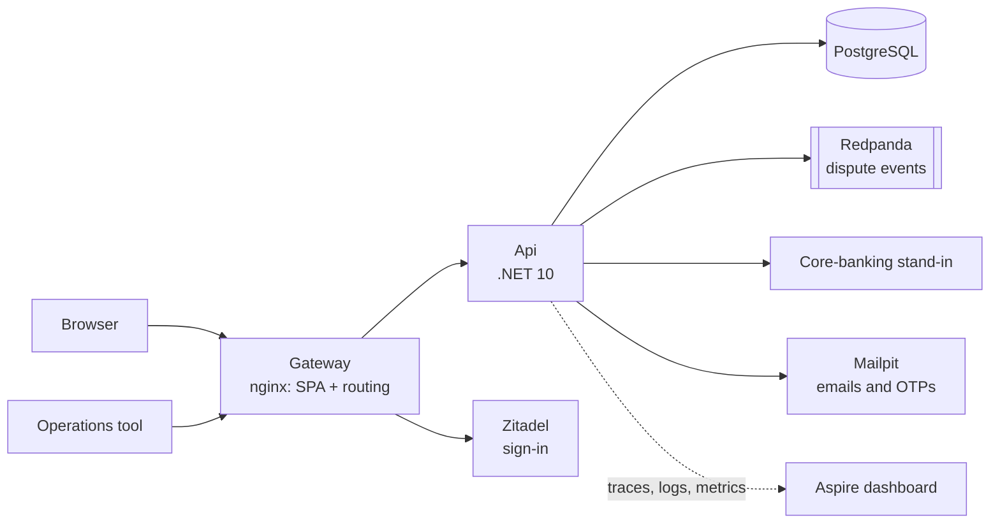
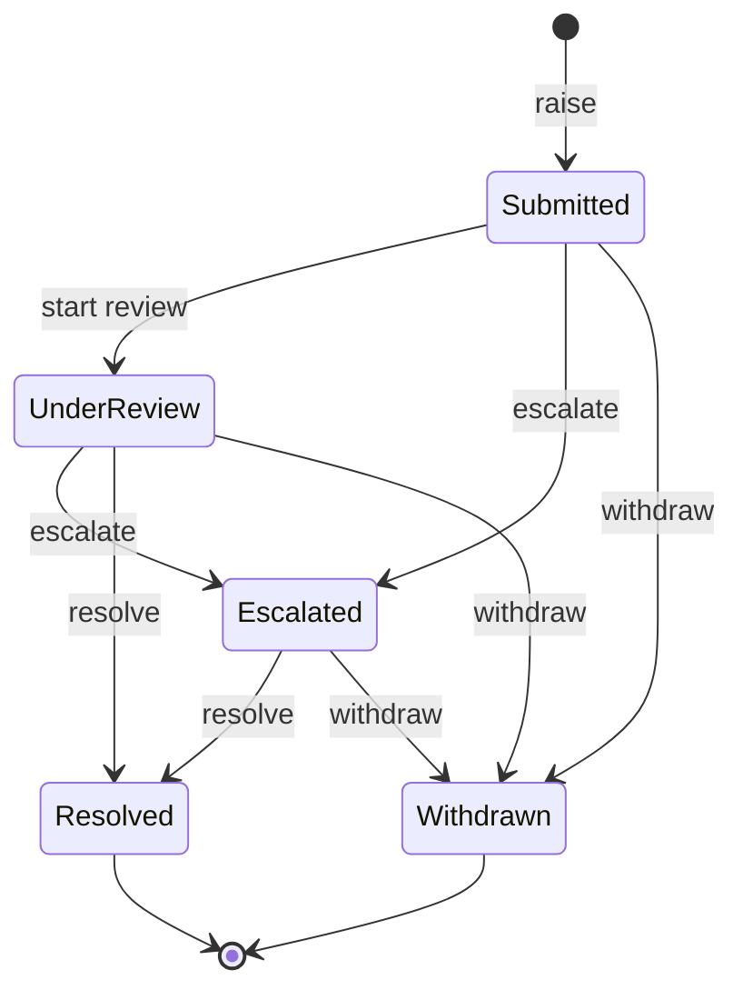
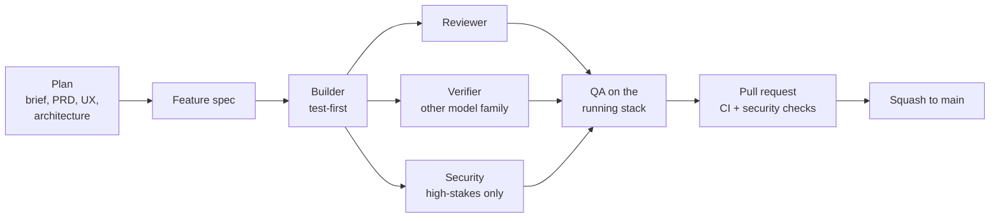

# DisputeDesk

A customer portal for card disputes. A customer signs in, links their login to their bank record, picks a card
transaction and raises a dispute, then follows it to an outcome. Operations tools act on disputes through the API, an
SLA sweep escalates disputes left open too long, and every change is published as a dispute event.

Everything runs locally in one Docker Compose stack, with synthetic data only.



The same stack also runs on AWS behind CloudFront ([Deployed on AWS](#deployed-on-aws)).

## Tech stack

| Area | Built with |
|---|---|
| Backend | .NET 10 minimal APIs, EF Core 10 on Npgsql, a transactional outbox; xUnit v3 with Testcontainers |
| Frontend | React 19 and TypeScript on Vite, TanStack Query and Router, shadcn/ui on Tailwind, an API client generated by Orval |
| Data and events | PostgreSQL 18; Redpanda (Kafka API) carrying dispute events as CloudEvents |
| Identity | Zitadel v4 (OpenID Connect), with server-side browser sessions: the browser holds one cookie, never a token |
| Edge and observability | An nginx gateway; OpenTelemetry to the Aspire dashboard locally, X-Ray and CloudWatch on AWS |
| Delivery | Docker Compose; Terraform on AWS (EC2, RDS, CloudFront, SSM); GitHub Actions with CodeQL, Trivy and ZAP; Playwright |

Exact versions are in the [architecture's Stack table](docs/architecture/architecture.md#stack).

## Run it

You need Docker with Compose v5.6.0 or later, and port 8080 free.

```sh
docker compose up --build --wait     # the first build takes a few minutes; returns when everything is healthy
```

Open <http://localhost:8080> and sign in as `thandi.nkosi` / `Dev-Only-Pass-A1`.

| What | Where |
|---|---|
| The app | <http://localhost:8080> |
| Sign-in (Zitadel) | <http://auth.localhost:8080> |
| Mailpit: verification emails and linking OTPs | <http://localhost:8025> |
| Aspire dashboard: traces, metrics, logs | <http://localhost:18888> |
| API reference (Scalar) | <http://localhost:8080/scalar/> |

The seed's dates are relative to start-up. To start again from the seed, after a day boundary or after running the
e2e tests, run `docker compose down -v`, which deletes all data, then `up` again.

## Try it

| Customer | Sign in with | What it shows |
|---|---|---|
| A | `thandi.nkosi` / `Dev-Only-Pass-A1` | Linked, with a dispute in every status |
| B | `pieter.vanwyk` / `Dev-Only-Pass-B1` | Linked, with one dispute that A cannot see |
| C | `ayesha.patel` / `Dev-Only-Pass-C1` | Not linked. Linking is refused because of a recent SIM swap: ID `9202295801081`, account `1000000031` |
| D | sign up a new login | Not linked and passes every check: ID `8804125123080`, account `1000000041` |

The values are synthetic and dev-only, and the AWS demo uses the same logins. [backend/fixtures/](backend/fixtures/README.md)
has the full seed.

1. **As A**, raise a dispute on a recent card debit, then withdraw it. Watch the timeline.
2. **Wait about 5 minutes** after start-up: A's dispute on `TXN-A-0011` is escalated by the SLA sweep.
3. **As B**, open one of A's dispute links: *not found*.
4. **As C**, try to link: refused.
5. **Sign up a new login** and link it to D. The OTP arrives in Mailpit, which stands in for SMS here. A real
   deployment texts it to the cellphone on the bank's record. In AWS, Mailpit's UI sits behind basic auth
   ([post-deploy check 3](infra/terraform/README.md#post-deploy-checks)).
6. **As an operations tool**, run `scripts/operations-token.sh` and paste the token into Scalar's `bearer` scheme. Then call
   `start-review`, `escalate` and `resolve` on A's Submitted dispute on `TXN-A-0026`:

   | Request | Expect |
   |---|---|
   | `GET /api/v1/operations/disputes/{disputeId}` | 200, `submitted` |
   | `POST …/start-review`, then `…/escalate` | 200, `underReview`, then `escalated` |
   | `POST …/resolve` with `{"outcome": "upheld", "note": "Refund approved."}` | 200, `resolved` |
   | The same `resolve` again | 409, `action-not-allowed` |

   The dispute ID is in A's browser URL (`/disputes/<id>`).

## Deployed on AWS

One environment, `dev`, runs the same Compose stack in af-south-1 (Cape Town) and stays within the AWS free tier.

| Part | What |
|---|---|
| Entry | Three CloudFront distributions (app, sign-in, Mailpit) are the only way in. Plain HTTP is redirected or refused |
| Compute | One EC2 c7i-flex.large runs the Compose stack. It has no SSH and accepts traffic only from CloudFront |
| Data | RDS PostgreSQL 18 on db.t4g.micro, in private subnets, with TLS required |
| Secrets | SSM Parameter Store, encrypted with KMS |
| Observability | An OpenTelemetry Collector sends traces to X-Ray (Transaction Search), and logs and metrics to CloudWatch |
| Cost | A monthly budget emails at 80 % of actual spend or 100 % of forecast spend |
| Deploys | By hand. Dispatch `deploy.yml` with a commit on `main`, and GitHub waits for the owner's approval. The deploy then runs through OIDC and SSM Run Command |

- **The layout:** [infra/README.md, Deployed on AWS](infra/README.md#deployed-on-aws) has the architecture diagram
  and the deploy sequence.
- **Running it:** [infra/terraform/README.md](infra/terraform/README.md) covers standing it up, the post-deploy
  checks, rollback and destroy.
- **Why it is shaped this way:** [AD-28](docs/architecture/architecture.md#ad-28---aws-dev-environment-adopted) and the
  [deployment view](docs/architecture/architecture.md#deployment-view-aws-dev).

## The dispute lifecycle



- Operations start the review, escalate and resolve; the outcome is Upheld or Rejected.
- The SLA sweep escalates a dispute still open 10 days after submission.
- The customer withdraws.
- Customers see Escalated as *Under review (prioritised)*.
- Any other action returns 409.

## What's in the repo

| Folder | What |
|---|---|
| [`backend/`](backend/README.md) | The .NET 10 Api, Worker, core-banking stand-in, tests and seed data |
| [`frontend/`](frontend/README.md) | The React single-page app |
| [`infra/`](infra/README.md) | The gateway and identity images, the AWS environment (Terraform), the deploy, platform tests |
| `contracts/` | JSON Schemas of the published dispute events |
| `e2e/` | Playwright journeys and regression specs against the running stack |
| [`docs/`](docs/README.md) | Brief, PRD, UX, architecture, decisions and how the solution was built |
| `scripts/` | Developer and pipeline scripts |
| `.github/` | CI, security and deploy workflows, and the `main` ruleset |
| `.claude/`, `_bmad/`, `AGENTS.md` | The AI-assisted delivery setup: agents, skills, guard hooks, rules |

> **One repo standing in for three.** `backend/`, `frontend/` and `infra/` are laid out as each team's own repository
> would be. Each one reads another only through a published contract: the OpenAPI file, the event schemas, the images.
> In a real organisation they would be three repositories. Here they share one, so a reviewer can clone, run and read
> the whole solution in one place ([ad-011](docs/decisions/ad-011-team-folders-in-one-repo.md)).

## How it was built

The solution was planned with the BMAD method and built through an agentic SDLC. One supervisor session dispatched each
story to AI agents, and a human approved every product and architecture decision.



Guard hooks, a pre-commit hook and the `main` ruleset enforce the rules, so no change reaches `main` without passing
its checks. The roles, gates and inspirations are in [docs/](docs/README.md#how-it-was-built).

## Build and test

Each area's README has its full command list. In short:

| Area | Command |
|---|---|
| Backend | `cd backend && dotnet test --solution DisputeDesk.slnx` (needs Docker) |
| Frontend | `cd frontend && npm ci && npm test` |
| Platform | `cd infra/tests && dotnet test --project DisputeDesk.PlatformTests` |
| End to end | `cd e2e && npm ci && npx playwright install chromium && npm run journeys` (on a fresh stack) |

- CI ([ci.yml](.github/workflows/ci.yml)) runs every check on every pull request.
- The longer e2e regression suite (`npm test`) runs only when a pull request touches a path in
  [scripts/regression-paths.list](scripts/regression-paths.list).

## Simplifications

- **The 90-day window** counts from the transaction date. The card schemes allow 120 days from their processing date.
- **The 10-day SLA** is an internal trigger, not a promise to customers. No South African rule fixes a number of days.
- **The scheme rule texts** (Visa, Mastercard) are not public. The time limits come from consistent secondary sources.
- **Linking rate limits** live in the memory of the one Api instance.

The sources are in the [dispute-lifecycle research](docs/research/dispute-lifecycle/dispute-lifecycle.md). Everything
deferred is in the [production path](docs/production-path.md).

## Where next

| To see | Read |
|---|---|
| The design and its decisions | [architecture](docs/architecture/architecture.md), [decision records](docs/decisions/) |
| Operating the local stack | [runbook](infra/deploy/runbook.md) |
| Deploying to AWS | [infra/terraform/](infra/terraform/README.md) |
| Working on the code | [onboarding](docs/onboarding.md), [AGENTS.md](AGENTS.md) |
| What is deferred, and the accepted risks | [production path](docs/production-path.md) |

### Where each quality area is met

| Quality area | Where |
|---|---|
| Architecture and scalability | [architecture](docs/architecture/architecture.md), [layer tests](backend/tests/DisputeDesk.ArchitectureTests/LayerTests.cs) |
| Resilience and operational readiness | [outbox relay](backend/src/DisputeDesk.Infrastructure/Outbox/OutboxRelay.cs), [Compose health checks](docker-compose.yml), [runbook](infra/deploy/runbook.md) |
| Data and domain modelling | [ad-009 stored events](docs/decisions/ad-009-stored-events.md), [domain tests](backend/tests/DisputeDesk.Domain.Tests/) |
| API design | [openapi.json](backend/openapi.json), [problem types](docs/problems/) |
| Security (primary) | [ad-007 browser session](docs/decisions/ad-007-browser-session.md), [ad-008 linking](docs/decisions/ad-008-linking.md), [gateway](infra/images/gateway/) |
| Code quality and maintainability | [AGENTS.md](AGENTS.md), [build rules](backend/Directory.Build.props), [ESLint config](frontend/eslint.config.js) |
| Testing | [backend tests](backend/tests/), [e2e journeys](e2e/tests/journeys/) |
| Observability | [telemetry](backend/src/DisputeDesk.Infrastructure/Observability/Telemetry.cs), [architecture AD-20](docs/architecture/architecture.md) |
| Infrastructure and DevOps | [Compose stack](docker-compose.yml), [CI](.github/workflows/ci.yml), [security scans](.github/workflows/security.yml), [Terraform](infra/terraform/) |
| Documentation and communication | [docs/](docs/README.md), [decision records](docs/decisions/), [production path](docs/production-path.md) |
