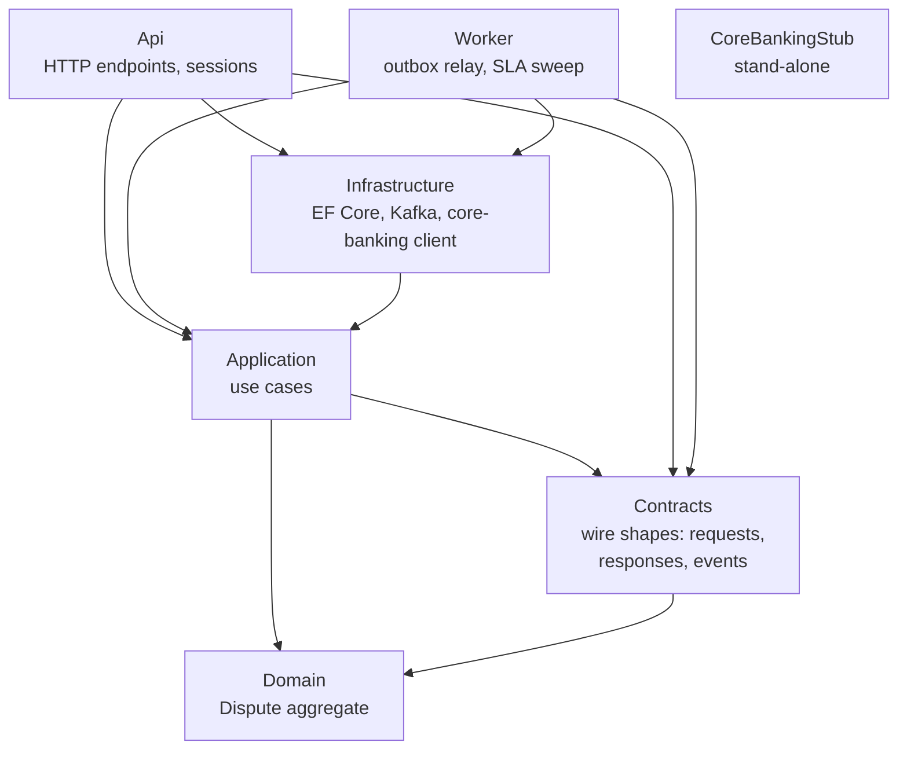

# backend

The backend team's folder: the Api, the Worker, the core-banking stub and their tests, in one .NET 10 solution,
`DisputeDesk.slnx`. Its rules are in [AGENTS.md](../AGENTS.md) and
[docs/conventions/backend.md](../docs/conventions/backend.md).



Each arrow is a project reference. `LayerTests` keeps Domain, Contracts, Application and the stub inside their arrows. Locally, the Api also
runs the Worker's relay and sweep in-process (`Worker:InProcess`).

| Folder | What |
|---|---|
| `src/` | Api, Worker, Application, Domain, Infrastructure, Contracts |
| `stubs/` | The core-banking stub: a stand-in for the bank's core banking and the SIM-swap check |
| `tests/` | Domain unit tests, integration tests (PostgreSQL via Testcontainers), architecture tests |
| `fixtures/` | `local.json`, the synthetic seed data ([fixtures/README.md](fixtures/README.md)) |
| `http/` | Requests for the developer smoke check |

## Build and test

From `backend/`, with Docker running and Compose installed. This matches CI's `backend` job:

```sh
dotnet build DisputeDesk.slnx
git diff --exit-code -- openapi.json                       # the build regenerates the contract
dotnet format style DisputeDesk.slnx --verify-no-changes
dotnet format whitespace DisputeDesk.slnx --verify-no-changes
dotnet tool restore
dotnet ef migrations has-pending-model-changes --no-build \
  --project src/DisputeDesk.Infrastructure --startup-project src/DisputeDesk.Api
dotnet test --solution DisputeDesk.slnx
```

## What it publishes

Other folders read these, never the backend's source:

- **`openapi.json`**, the API contract. CI fails if the build changes it.
- **Images.** CI publishes the `api-local`, `worker-local` and `core-banking` targets of `Dockerfile` as `api`,
  `worker` and `core-banking`. The `-local` targets add the probe that the Compose health checks call.
- **`fixtures/local.json`**, read by the stub, the seeder, Zitadel provisioning, `scripts/dev-login.sh` and `e2e/`.

## What it reads from the root

- `contracts/events/`: the JSON Schemas and samples of the published dispute events.
- `docs/problems/`: the pages that the ProblemDetails `type` URLs point to.
- In the tests only: `docker-compose.yml`, `scripts/`, and the gateway's `infra/images/gateway/templates/scalar-headers.conf.template`, whose Content-Security-Policy `ApiReferenceTests` keeps in step with the API's.
