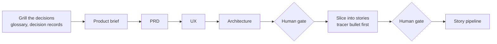
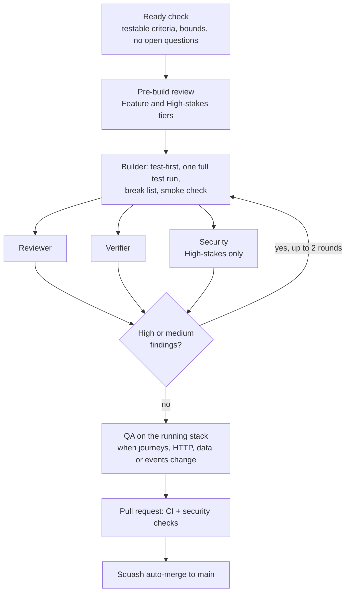

# docs

The planning documents, the decisions, and how the solution was built.

## Reading order for a reviewer

| # | Read | For |
|---|---|---|
| 1 | [product-brief/](product-brief/product-brief.md) | The problem and who it is for |
| 2 | [prd/](prd/prd.md) | Requirements with stable IDs (FR-n, NFR-…) |
| 3 | [ux/](ux/) | How it looks (`DESIGN.md`) and behaves (`EXPERIENCE.md`), with mockups |
| 4 | [architecture/](architecture/architecture.md) | The architecture spine (AD-1 to AD-32): diagrams, data model, endpoint map |
| 5 | [decisions/](decisions/) | Decision records ad-001 to ad-012 (ad-004 is in [process/](process/ad-004-model-roles.md)) |
| 6 | [production-path.md](production-path.md) | What is deferred, and the accepted risks |

## What's here

| Folder or file | What |
|---|---|
| `product-brief/`, `prd/`, `ux/`, `architecture/` | Planning documents, written with the BMAD skills |
| `research/` | Research behind decisions: dispute lifecycle, event versioning, EF Core upsert, projection naming |
| `decisions/` | Decision records (ad-NNN) |
| `glossary.md` | The domain terms everyone uses, and the synonyms to avoid |
| `conventions/` | Backend and frontend coding rules |
| `problems/` | One page per ProblemDetails `type` the API returns |
| `production-path.md` | Deferred scope and accepted risks |
| `onboarding.md` | Starting work on the code |
| `process/` | How the work is done (below) |
| `initiative-disputedesk.md`, `tickets/` | Records: the requirements as sliced into the original epics and stories |
| `backlog/` | Feature specs, the unit of new work since the epics closed |
| `verification/` | Records: the review, verification, security and QA evidence per story |

## How it was built

DisputeDesk was planned with the [BMAD method](https://github.com/bmad-code-org/BMAD-METHOD) and built through an
agentic SDLC: AI agents built and checked each story, and a human made every product and architecture decision.

### Roles

| Role | Who | Does |
|---|---|---|
| Decision-maker | The human | Answers the planning questions, approves the gates, decides contested points |
| Supervisor | The main Claude Code session | Plans, dispatches, tracks and merges. Writes no code |
| Builders | `backend-builder` (Claude Opus), `frontend-builder` (Claude Sonnet) | Build one story test-first, in an isolated worktree |
| Reviewer | Claude Opus, read-only | Reviews the story before the build, then the diff for correctness |
| Verifier | GPT-6 Astra through GitHub Copilot CLI | A different model family re-checks the builder's evidence and runs its break list |
| Security | Claude Opus, read-only | Reviews every high-stakes story: auth, identity, customer data, money, migrations |
| QA | Claude Sonnet with Playwright | Traces each criterion through browser → network → database → events |

[ad-004](process/ad-004-model-roles.md) explains the model choices.

### From idea to stories

New work now enters as a **feature spec**: `backlog/story-<id>.md`, listed in the Features table of
[tickets/README.md](tickets/README.md).

### One story through the pipeline

- **Stakes tiers** set the ceremony:

  | Tier | Ceremony |
  |---|---|
  | Trivial | Make the change, run the check |
  | Small | Test first |
  | Feature | The full flow |
  | High-stakes | The full flow, plus security and a human review of the diff |

- **Low findings** never block a story. They go to [verification/lows.md](verification/lows.md) and are fixed in batches.
- **A second fix round** that still leaves a high or medium finding goes to the human.

### What enforces the rules

Prose rules get broken, so the critical ones are checks:

| Check | Enforces |
|---|---|
| Guard hook (`.claude/hooks/guard.py`) | Each agent writes only its own area. Only the supervisor commits or merges. Any AWS or deploy action asks the human |
| Status-contract hook | Every agent ends with a machine-readable report |
| Pre-commit hook (`.githooks/`) | No secrets or forbidden terms reach history |
| CI floor guard | No new suppressions or banned packages |
| `main` ruleset | Changes arrive only by pull request, with `ci-passed`, `security-passed` and code scanning green, and squash merges only |

The full process is in [process/agentic-sdlc.md](process/agentic-sdlc.md). The rules every assistant follows are in
[AGENTS.md](../AGENTS.md).

### Inspirations

| Source | Taken |
|---|---|
| [BMAD Method](https://github.com/bmad-code-org/BMAD-METHOD) (pinned) | Brief, PRD with stable IDs, UX, the architecture spine, slicing into stories, review lenses, research |
| [skills](https://github.com/mattpocock/skills) | Grilling in batched rounds; the glossary kept current while grilling |
| [agent-skills](https://github.com/addyosmani/agent-skills) | Definition of done, safety rails, the floor guard |
| pstack | A verifier from another model family, verdicts keyed by commit, one writer per file |

What is original here:
- QA that follows every criterion through four hops, from browser to events.
- Builder smoke checks over real HTTP against a real identity provider.
- Builders split by area, with a model chosen for each.

What was taken and what was left out, and why, is in [process/workflow-sources.md](process/workflow-sources.md).

None of this is needed to run the solution (Docker only) or to work on it (any assistant following `AGENTS.md`).
