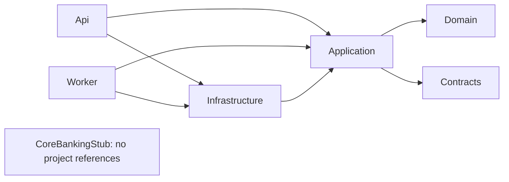
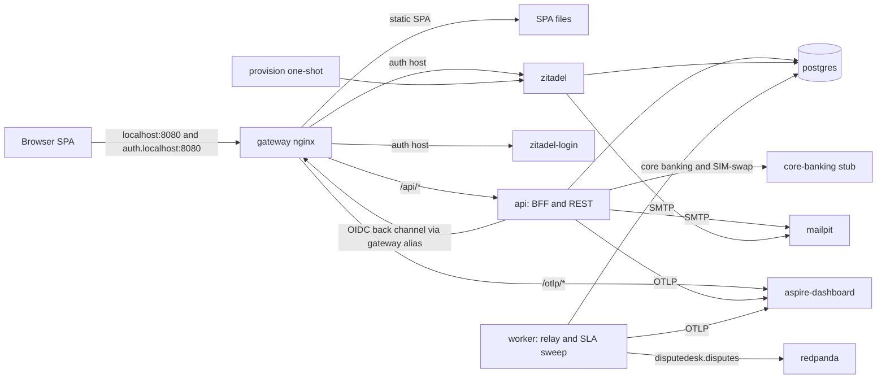
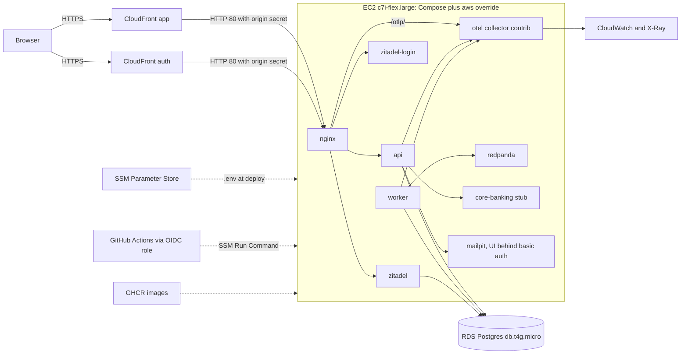
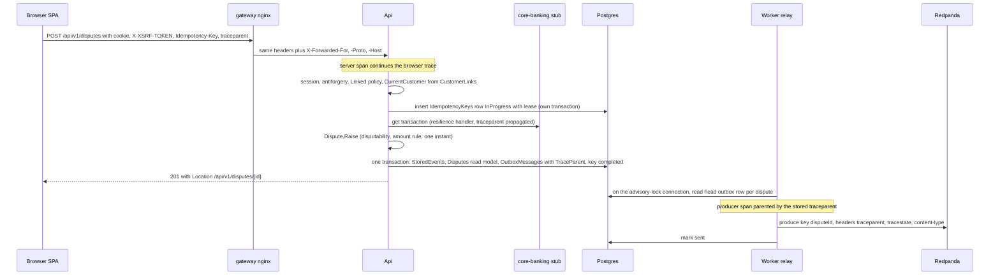
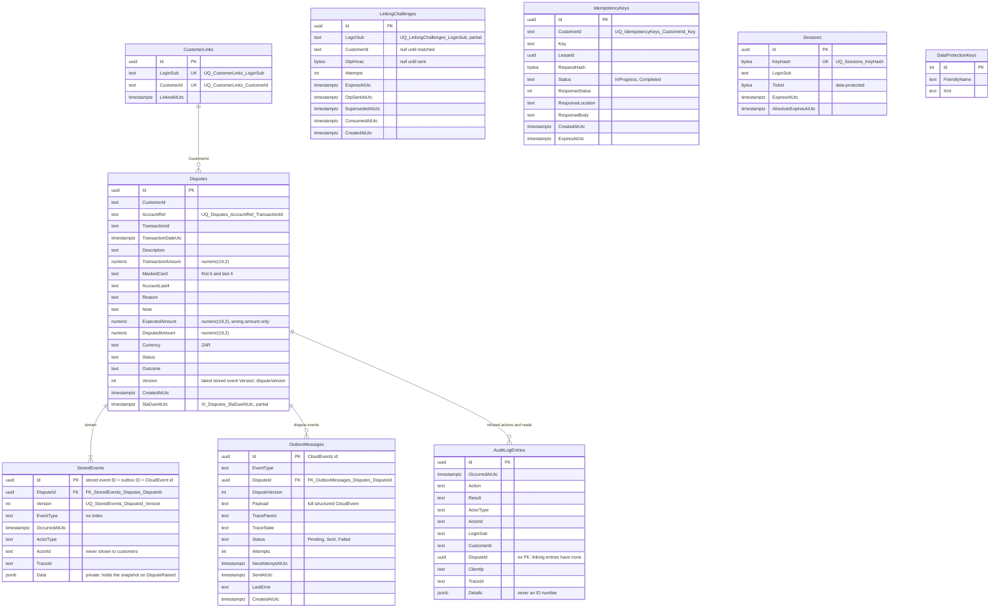

# Architecture Spine - DisputeDesk

This spine is the consistency contract for every DisputeDesk story. Each `AD-n` fixes something that two separately built stories could otherwise get incompatibly wrong. `[ADOPTED]` means an earlier decision or merged code already settled it. `Accepted 2026-10-26` marks the five recommendations accepted at Gate 1. Any other `[ASSUMPTION]` is an inference made in this headless run. The PRD keeps the testable detail. Where the PRD and merged code differ, see *PRD and code divergences*.

## Design Paradigm

**Clean Architecture (ports and adapters) with feature folders.** Dependencies point inward. Domain holds the rules, Application holds the use cases, and Infrastructure is the only layer that knows about Postgres, Kafka, HTTP clients or SMTP. Two hosts compose them: the **Api** (BFF and REST) and the **Worker** (outbox relay and SLA sweep). Two patterns sit on top: a **backend-for-frontend**, so the browser holds only a cookie, and a **transactional outbox**, so every published dispute event commits with its change. Each dispute change is a **stored event** in the dispute's own append-only stream (ad-009); a handler loads a dispute by replaying its stream, and the `Disputes` row is a read model of that stream.

| Layer | Project (`backend/src/`) | Holds |
| --- | --- | --- |
| Domain | `DisputeDesk.Domain` | `Dispute` aggregate and its stored event types, action rules, disputability, money, `Result`/`Error` |
| Contracts | `DisputeDesk.Contracts` | Wire shapes only: API request and response records, dispute event records, problem slugs, audit vocabulary. References nothing |
| Application | `DisputeDesk.Application` | Feature folders (`Linking/`, `Transactions/`, `Disputes/`, `Operations/`, `Sla/`) with handlers, the three ports, `IAppDbContext`, `CurrentCustomer` |
| Infrastructure | `DisputeDesk.Infrastructure` | `AppDbContext`, migrations, port adapters, outbox relay, Kafka producer, session store, telemetry |
| Api | `DisputeDesk.Api` | Endpoint groups per feature, auth schemes and policies, ProblemDetails mapping, BFF endpoints |
| Worker | `DisputeDesk.Worker` | Hosted services that run the relay and the sweep |



Only these arrows are allowed. Api and Worker reach Contracts transitively. `LayerTests` already enforces part of the graph: Domain references nothing, Application never references Infrastructure or Npgsql, only Infrastructure implements `IAppDbContext`, and Api and Worker are the only hosts. The story that first needs each missing rule adds it: Contracts and Domain reference no other project, the stub is isolated, and the `IgnoreQueryFilters(["Ownership"])` and `AddDbContextPool` checks (AD-11).

## Invariants & Rules

### AD-1 - Clean Architecture with feature folders [ADOPTED]

- **Binds:** all backend stories, R25
- **Prevents:** a handler reaching Npgsql or HTTP directly; features split by technical kind; wire shapes duplicated across layers
- **Rule:** Keep the six projects and the reference graph above. Application gains the reference to Contracts. Code is grouped by feature folder (`Disputes/RaiseDispute/...`). Each Api endpoint calls one Application handler, a plain class registered in DI, and handlers return Contracts response records. There is no mediator library. Each feature registers itself through its own `Add<Feature>`/`Map<Feature>` extension, so `Program.cs` gains one line per feature. A new host or project needs an AD amendment.
- **Rejected:** vertical slices alone (no enforceable domain boundary); N-tier with repositories; MediatR CQRS (banned by AGENTS.md); Contracts records duplicated inside Application.

### AD-2 - EF Core directly behind `IAppDbContext` [ADOPTED]

- **Binds:** every story that persists data, R29
- **Prevents:** a repository layer growing beside EF; Application binding to a provider; every story editing the same interface
- **Rule:** `IAppDbContext` exposes `Entities<TEntity>()`, which `AppDbContext` forwards to `Set<TEntity>()`, and `SaveChangesAsync`. The interface member is not named `Set` because CA1716 rejects a keyword as a member name (decided 2026-10-28, story 3.1). Stories add an entity and its `IEntityTypeConfiguration` in their feature folder and never edit the interface. Application may reference `Microsoft.EntityFrameworkCore` but never `Npgsql.*`. Raw SQL is allowed only where EF can't express it (`FOR UPDATE SKIP LOCKED`, advisory locks, the conditional linking updates), in one named, parameterised Infrastructure method with a justification comment. Table, column and constraint names are PascalCase, which is what EF Core and Npgsql generate by default, so no naming-convention package is added (no `EFCore.NamingConventions`, no snake_case conversion). The full naming rules are in *Database naming* (`docs/conventions/backend.md`) and AD-22. Handwritten SQL double-quotes every identifier. Each story adds one migration, generated after rebasing onto main. On a snapshot conflict the builder deletes and regenerates the migration and never hand-merges. CI runs `dotnet ef migrations has-pending-model-changes`.
- **Rejected:** repository and unit-of-work wrappers; Dapper for reads; a `DbSet` property per entity on the interface.

### AD-3 - Errors: one kind set, one mapping, one slug catalogue [ADOPTED, extended]

- **Binds:** every endpoint, R20, R30
- **Prevents:** stories inventing status codes or problem types; framework responses without a body; the SPA routing on message text
- **Rule:** Domain and Application return `Result` with an `Error` for expected failures and throw only for the unexpected. `ErrorKind` is exactly: `NotFound` (404), `Validation` (400, with field errors), `Forbidden` (403), `ActionNotAllowed` (409, adds the caller's view of the current status), `Conflict` (409), `BusinessRule` (422), `Unavailable` (503) and `RateLimited` (429 `rate-limited`, used by the full linking queue; decided 2026-10-30, story 6.5). `ErrorResults.ToProblem` is the only place an `Error` becomes HTTP. Malformed input gets 400 from the built-in minimal API validation (`AddValidation`). Domain field rules (expected amount, trimmed note length) also return `Validation` and so 400, with the same shape. Errors never echo a value. Every problem body has `type` = `https://github.com/njabulozmnisi/disputedesk/blob/main/docs/problems/<slug>.md`, a resolvable URL whose page gives the title, the status, when it happens and what the client should do (RFC 9457 §3.1.1 encourages resolvable type URIs; decided 2026-10-27, story 2.7), `traceId` (already global) and camelCase `errors` keys, set in `CustomizeProblemDetails`. Framework responses get bodies too: the cookie and JwtBearer challenge and forbid events only set 401 and 403, the rate limiter's `OnRejected` writes `rate-limited` with `Retry-After` through `ErrorKind.RateLimited` and `ErrorResults.ToProblem`, sharing the full queue's problem type, an antiforgery failure is `validation`, and `UseStatusCodePages` writes every other bodiless error with the slug its status implies (401 `unauthorized`, 403 `forbidden`). Slugs are constants in Contracts, one class per feature, gathered by a test: `validation`, `not-found`, `action-not-allowed`, `already-disputed`, `not-disputable` (adds `reason`), `idempotency-in-progress`, `idempotency-mismatch`, `linking-required`, `already-linked`, `otp-incorrect` (adds `attemptsRemaining`), `linking-locked`, `rate-limited`, `core-banking-unavailable`, `unauthorized`, `forbidden`, `internal`. A test asserts every Domain and Application error code is in the catalogue. The SPA identifies a problem by its full `type` URI, as RFC 9457 §3.1.1 makes it the identifier: one function builds `<base>/<slug>.md` from a single base constant, and the SPA compares with `===` (decided 2026-10-28, story 2.4; it replaces routing on the last path segment). One exception to the body shape: the gateway's own 429 (AD-23) carries no `traceId`, because nginx has no trace context (decided 2026-10-27).
- **Rejected:** exceptions for control flow; FluentResults or ErrorOr; tag URIs (`tag:disputedesk,2026:problem:<slug>`, used until 2026-10-27: nothing resolves, and `disputedesk` is not the fully qualified authority RFC 4151 requires); `invalid-transition` (the glossary rules out "transition").

### AD-4 - Time, money and identifiers [ADOPTED]

- **Binds:** R12, R14, R22, R29, R30
- **Prevents:** clock reads tests can't control; one change stamped with several instants; floating-point money
- **Rule:** Each use case reads `TimeProvider.GetUtcNow()` once, at the start of the handler or of each sweep or relay batch, and passes that instant into the aggregate. The aggregate and the AD-14 commit copy it to `StoredEvents.OccurredAtUtc`, `OutboxMessages.CreatedAtUtc`, the CloudEvent `time` and `occurredAt`; `AuditLog.Record` stamps an audit row with its caller's instant. The one exception is the seeder (AD-30): it reads the clock once for its anchor and gives each seeded action its own back-dated instant resolved from the fixture. An AD-15 retry takes the later of the use-case instant and the stream's latest instant, without reading the clock again. Raise sets `CreatedAtUtc` to that instant and `SlaDueAtUtc` to it plus 240 hours. SQL never calls `now()` or `CURRENT_TIMESTAMP`, and no column has a time default. Raw SQL takes `@now` as a parameter, and a source-rules test greps for those functions. Every timestamp is UTC `timestamptz`. South African time is a fixed UTC+02:00 offset, used only by the Domain's 90-day rule and the SPA's display. Money is `decimal` in C# and `numeric(19,2)` plus an ISO 4217 code in Postgres. In JSON, responses carry `{ "amount": "849.00", "currency": "ZAR" }` with exactly two decimals, and requests send a bare decimal string with ZAR implied. Dispute IDs and event IDs are UUIDv7 (RFC 9562; `Guid.CreateVersion7`, from the use-case instant), sent as strings. Note length is counted in UTF-16 code units after trimming, on both sides.
- **Rejected:** `DateTime.UtcNow`; NodaTime; `double`; prefixed string IDs.

### AD-5 - HTTP API shape [ADOPTED]

- **Binds:** every endpoint, the SPA, R30
- **Prevents:** a generic status endpoint; offset paging; casing drift; a stale frontend contract
- **Rule:** .NET 10 minimal APIs. Every resource route is under `/api/v1`. The only exceptions are the OIDC callbacks (AD-7) and `/health/*`. Each action has its own endpoint, named after it. Lists use keyset pagination with an opaque base64url cursor: default 20, maximum 50, and an undecodable cursor gets 400. A page is `{ "items": [...], "nextCursor": "..." }`, with `nextCursor` null on the last page. Transactions are ordered by transaction date then transaction ID, disputes by `CreatedAtUtc` then `Id`, both newest first. The disputes list has no filter in v1, and the SPA groups the pages it has loaded into open and closed. JSON property names and enum values are camelCase (`underReview`, `startReview`), through one shared `JsonSerializerOptions` with `JsonStringEnumConverter(JsonNamingPolicy.CamelCase)`, used by both API and events. C# enum members are PascalCase (`UnderReview`, `StartReview`). The built-in OpenAPI document is generated at build time to `backend/openapi.json`, committed and drift-checked (`ci.yml`). Every `Location` header points to a real GET. Scalar is behind `Scalar:Enabled` (AD-26).
- **Rejected:** controllers; Swashbuckle; offset paging; a `PATCH` that sets the status; a hand-written OpenAPI file.

### AD-6 - Zitadel stands in for the bank's identity platform [ADOPTED]

- **Binds:** R1, R2, R3, R21, R37
- **Prevents:** DisputeDesk building sign-up, password or verification logic; each of two stories assuming the other enforces email verification
- **Rule:** Zitadel v4 (self-hosted, Login v2) owns logins, sign-up, email verification and password reset. It is configured zero-click: FirstInstance and DefaultInstance environment variables, plus the idempotent `provision.sh`, which writes client settings to `zitadel-clients.json` under the configuration keys in AD-26. The hosted pages are themed through the label policy, generated from the theme tokens at provisioning time. Unverified logins are blocked twice: Login v2 requires email verification (`EMAIL_VERIFICATION`), and the BFF also rejects an ID token without `email_verified: true` in `OnTokenValidated`. DisputeDesk never calls Zitadel management APIs at runtime.
- **Rejected:** Keycloak (the fallback, unused); Duende IdentityServer (banned); a mock OIDC server.

### AD-7 - BFF session model [ADOPTED]

- **Binds:** R2, R3, R26, the SPA
- **Prevents:** a token reaching the browser; lost sessions; session fixation; idle sign-out earlier than 15 minutes; a CSRF-able logout
- **Rule:**
  - **Sign-in.** The Api is the confidential client of a backend-for-frontend (RFC 10017 §6.1, OAuth 2.0 for Browser-Based Applications): the built-in OpenID Connect handler (code flow, PKCE, `client_secret_post`, matching the provisioned Zitadel app) and the built-in cookie handler. The BFF app has only the authorization-code grant.
  - **Server-side session.** The cookie holds only a session key. An `ITicketStore` in Api keeps the ticket in `Sessions` (the Worker image lacks the ASP.NET Core shared framework that defines `ITicketStore`). `StoreAsync` always mints a new 256-bit random key, and the row stores its SHA-256 in `KeyHash`. `RetrieveAsync` checks `ExpiresAtUtc` and `AbsoluteExpiresAtUtc` against `TimeProvider`, and deletes and rejects an expired row. Otherwise it moves `ExpiresAtUtc` forward on each request that carries the cookie; the absolute limit never moves. A successful link keeps the session and its key: linked state is read from `CustomerLinks` on every request, and the key is not renewed after linking, because it is minted server-side at sign-in and the store rejects any key it did not mint, so session fixation is already blocked (decided 2026-10-30, story 6.2; the built-in cookie handler renews the removed key when sign-out and sign-in run in one request; renewal at a privilege change is a production-path item). An hourly timer in the Api deletes expired rows.
  - **Keys and tokens.** Data Protection keys persist to Postgres (`DataProtectionKeys`) locally. In AWS the key ring is stored with AWS's documented `Amazon.AspNetCore.DataProtection.SSM` package (`PersistKeysToAWSSystemsManager`) as SSM Parameter Store SecureStrings, encrypted at rest with KMS (decided 2026-10-27, story 7.4). Only the ID token is kept, inside the protected server-side ticket, for the end-session `id_token_hint`; access and refresh tokens are never stored.
  - **Expiry.** The idle limit is 15 minutes, renewed on every authenticated API request by the ticket store, not by the cookie: the cookie (no expiry date, only the session key) is written at sign-in and cleared at sign-out, never renewed, so a request in flight during logout cannot set it again (`ExpireTimeSpan` is the 12-hour absolute limit; decided 2026-10-30 after the logout-cookie race). The absolute limit is 12 hours. The SPA never polls. Two minutes before the idle limit it shows a warning dialog whose "Stay signed in" calls `GET /api/v1/bff/session`, an authenticated request that renews the idle limit (WCAG 2.2 SC 2.2.1 Timing Adjustable; decided 2026-10-27, story 2.4).
  - **Endpoints.** `GET /api/v1/bff/login?returnUrl=` accepts only local paths (`IsLocalUrl`) and otherwise uses `/`. `GET /api/v1/bff/session` returns `{ "state": "anonymous" | "unlinked" | "linked" }`. `GET /api/v1/bff/antiforgery` returns the request token. `POST /api/v1/bff/logout` is a top-level form POST carrying `__RequestVerificationToken`. It validates antiforgery only for an authenticated caller, deletes any session row the cookie names, clears the session and antiforgery cookies, and redirects to Zitadel end-session with `client_id` `post_logout_redirect_uri` = the app origin's `/api/signout-callback-oidc` (the handler's `SignedOutCallbackPath`, which then lands the browser on `/`), and the session's `id_token_hint`, so Zitadel ends its session without a prompt (an anonymous logout sends no hint). The ID token crosses the browser only in that one redirect, already spent and short-lived; without it Zitadel asks for a click and its session outlives sign-out. The redirect is made by the OIDC handler's built-in `SignOutAsync`, which also sends `state` (OpenID Connect RP-Initiated Logout 1.0); story 2.8 builds it and records `SignOut` (AD-14a). A failed `SignIn` audit save stops the sign-in; a failed `SignOut` audit save is logged as an error and does not stop the sign-out, because logout must end the session (OWASP Session Management Cheat Sheet). Callbacks stay at `/api/signin-oidc` and `/api/signout-callback-oidc`.
  - **CSRF.** `AddAntiforgery(o => o.HeaderName = "X-XSRF-TOKEN")` sets the header, and every unsafe customer and linking endpoint runs an `IAntiforgery` endpoint filter that reads it (OWASP synchronizer token pattern). The built-in antiforgery middleware validates only form-bound endpoints and never short-circuits, so Microsoft Learn documents calling `IAntiforgery` directly for these. No CORS policy is registered.
- **Rejected:** tokens in the SPA; a static `X-CSRF: 1` header alone; the Duende BFF (banned); Redis or a cookie-held ticket.

### AD-8 - Two credential types, pinned per endpoint group; one check order [ADOPTED]

- **Binds:** R9, R19, R20, R21
- **Prevents:** an endpoint that takes both credentials; a sign-in redirect on an API call; 400 winning over 404
- **Rule:** **Customer** routes (`/api/v1/transactions`, `/api/v1/disputes...`) and **linking** routes (`/api/v1/linking/...`) accept only the cookie scheme. **Operations** routes (`/api/v1/operations/disputes/...`) accept only JwtBearer. Every policy pins its scheme. The cookie scheme's `OnRedirectToLogin` and `OnRedirectToAccessDenied` events return 401 and 403, so the wrong or a missing credential never gets a 302. JwtBearer validates issuer, audience (the Zitadel project ID), lifetime and signature, with `MapInboundClaims = false` and `RoleClaimType = "role"`. Checks run 401, 403, 404, 400, 409 (FR-24). Endpoints with an ID in the route and a body (withdraw, resolve) call `.DisableValidation()`. A request the framework cannot bind (a route ID that is not a GUID, no body, malformed JSON, a wrong JSON type, an enum value that is a number, a list or an unknown name) gets the framework's 400 `validation` after 401 and 403 and before the lookup, and a non-JSON body gets 415 `validation`; there is no custom body reading (Microsoft Learn, *Parameter binding in minimal APIs*). Only a well-formed body is checked after the lookup: the handler loads the dispute first (404), then checks the body with the same 400 shape, before the status (409) (decided 2026-10-30, story 5.2, as story 3.4 settled for withdraw). An endpoint whose resource ID travels in the body (raise) keeps automatic validation, because a body too malformed to name a resource cannot be looked up: it runs 401, 403, 400 for the body's shape, then 404, 409, 422, and last 400 for rules that need the loaded resource (an expected amount below the transaction amount) (decided 2026-10-28, story 3.1). A cookie-scheme 401 carries no `WWW-Authenticate` header. RFC 9110 §15.5.2 requires one on every 401, but no challenge scheme for cookies is standardised, so this is a deliberate deviation (decided 2026-10-27). JwtBearer 401s carry `WWW-Authenticate: Bearer` (RFC 6750 §3, story 5.1). Resolve, the one operations endpoint with a JSON body, adds `AcceptsMetadata` with no content types, so routing never hands a non-JSON body to the framework's policy-less 415 endpoint, which the cookie-only fallback would answer with a cookie 401; the endpoint's own JSON binding still answers 415, after its bearer policy (decided 2026-10-30, story 5.2; "last metadata wins" is documented for `EndpointMetadataCollection.GetMetadata<T>`, the empty list meaning any content type is the behaviour of aspnetcore `src/Http/Routing/src/Matching/AcceptsMatcherPolicy.cs`, pinned by `Resolve_TextPlainBodyWithNoTokenOrARefusedToken_Returns401BearerOr403Before415` and `Resolve_TextPlainBody_Returns415ValidationAndWritesNoRow`).
- **Rejected:** a fallback policy that also accepts JwtBearer (any validly signed project token would then satisfy deny-by-default everywhere); one policy scheme that picks cookie or bearer per request; antiforgery on the operations group; changing the PRD's check order.

### AD-9 - Operations roles and actor mapping [ADOPTED]

- **Binds:** R20, R21, FR-30
- **Prevents:** roles that encode who the caller is; tokens without roles; actor identity used to decide
- **Rule:** There is one Zitadel project role per action (`dispute.startReview`, `dispute.escalate`, `dispute.resolve`) plus `dispute.read` (FR-30). Role keys are camelCase after the `dispute.` prefix (Gate 2, 2026-10-26). Operations clients request the scope `openid urn:zitadel:iam:org:project:id:<projectId>:aud urn:zitadel:iam:org:projects:roles`. `OnTokenValidated` flattens only `urn:zitadel:iam:org:project:<projectId>:roles` into one `role` claim per key; the generic `urn:zitadel:iam:org:project:roles` claim is not read, because it is not bound to this project and could carry another project's roles (decided 2026-10-30, story 5.1; ASVS 5.0 V10.3.2). There is one authorisation policy per role, named after it. `Operations:Actors:<sub>` maps a service account's `sub` to exactly one actor type (`operations`); no mapping means 403. Actor type and identity are recorded, never passed into a decision. The Worker acts as `automation` with identity `worker:sla-sweep`, in-process and without a token. Withdraw needs no role.
- **Rejected:** coarse roles; OAuth scopes as permissions; Zitadel Actions.

### AD-10 - Authorisation states and customer resolution [ADOPTED]

- **Binds:** R9, R17
- **Prevents:** the customer taken from a request field or the token subject; a single-implementation interface for the current customer
- **Rule:** Two policies: `Unlinked` (linking routes) and `Linked` (customer routes). A deny-by-default fallback policy requires an authenticated user on every endpoint without its own policy, and the BFF and health endpoints are marked `AllowAnonymous()` (Microsoft Learn, *Policy-based authorization*: require global user authentication; story 2.8). `CurrentCustomer` is a concrete scoped class in `Application/Abstractions`. The `Linked` policy's authorization handler fills it on every customer request by looking up the login (`sub` from the session) in `CustomerLinks`; each policy names the cookie scheme (AD-8), and the documented `IAuthorizationMiddlewareResultHandler` writes the 403 problem, so 401 and 403 always come before binding and validation (400). Handlers and `AppDbContext` read only that class, and the Worker never sets it. An unlinked login on a customer route gets 403 `linking-required`; a linked login on a linking route gets 403 `already-linked`. Handlers never read `HttpContext.User`.
- **Rejected:** a customer-ID claim stamped at sign-in (stale after linking); an `ICurrentCustomer` interface (AGENTS.md); Zitadel metadata as the link store; an endpoint filter (it runs after built-in validation, so 400 could beat 403); claims transformation (runs on every authenticate call, more than once per request).

### AD-11 - Ownership by global query filter, two named bypasses [ADOPTED]

- **Binds:** R17, every query over disputes, their stored events and their timelines
- **Prevents:** a forgotten `Where` leaking another customer's dispute, stored events or timeline; a filter that bakes in the first customer's ID; a customer path reusing an operations loader
- **Rule:**
  - **The filter.** `AppDbContext` adds the EF Core 10 named query filter `"Ownership"` to `Dispute`, an expression over an instance member, `d => d.CustomerId == CurrentCustomerId`, set per context from `CurrentCustomer`. It never uses a captured local or a static. With no current customer it matches nothing. `AddDbContextPool` is forbidden.
  - **Stored events and timelines.** `StoredEvent` (ad-009) is reachable only through its dispute's stream and carries the same named filter through its dispute (EF Core *Global query filters*: filter the required dependent through its navigation). Loading by replay and the timeline both read the stored events (AD-13), so no query reads `StoredEvents` without that filter outside the bypasses below.
  - **Bypasses.** `IgnoreQueryFilters(["Ownership"])` appears only in the `Operations/` feature folder and the Worker's sweep. An architecture test fails on any other use, and on `Disputes/` or `Transactions/` referencing `Operations/` or `Sla/`.
  - **Not found.** Another customer's dispute and an unknown ID return identical 404 bodies apart from `traceId`.
  - **Transactions.** Ownership is checked by `ICoreBankingClient`, which only answers for the given customer (AD-21).
- **Rejected:** a check in each handler; Postgres row-level security.

### AD-12 - Linking: uniform request, checks and send off the request path

- **Binds:** R4 to R8, R10
- **Prevents:** response, timing or tries-left revealing a match; an OTP before the SIM-swap check; the ID number persisted; a stale job sending a code; the cap overrun
- **Rule:**
  - **Order.** The SIM-swap check runs before any OTP is sent [ADOPTED].
  - **Start.** `POST /api/v1/linking/start` validates format (400 names the field and never echoes it). It sets `SupersededAtUtc` on the login's earlier challenge, inserts a blank challenge row and calls `TryWrite` on a bounded in-memory `Channel` (capacity 100). The job holds `challengeId`, `loginSub`, `clientIp`, the parent `ActivityContext`, and the ID and account numbers in memory only. Every well-formed start returns **202 with one fixed body**. A full channel returns 429 `rate-limited` (`ErrorKind.RateLimited`, no `Retry-After`) to everyone and is audited (decided 2026-10-30, story 6.5).
  - **Background job.** A hosted service runs up to 4 jobs at once, each within a 10-second budget. In order: core-banking match, link check, then one explicit EF Core transaction whose first statement is the two-key `pg_advisory_xact_lock(<namespace>, <hash of the customer ID>)` (the two-key space never meets the relay's one-key lock), holding the 3-per-hour cap (challenges for the customer with `OtpSentAtUtc` in the last hour), then `ISimSwapCheck`, which fails closed, then the claim; it commits before the send (decided 2026-10-30, story 6.5). The claim is one conditional fill that sets `CustomerId`, `OtpHmac` (HMAC-SHA256 with `Linking:OtpHmacKey`), `OtpSentAtUtc` and `ExpiresAtUtc` = that instant plus 5 minutes, only where the row isn't superseded, consumed or already sent. `ISmsSender` runs only if exactly one row was updated. If `ISmsSender` fails, a second conditional update on that row clears `OtpHmac` and `ExpiresAtUtc` and keeps `OtpSentAtUtc`, so a failed send starts no lifetime but still counts toward the hourly cap: every claim counts, delivered or not, so at most three SMS reach a customer per hour (decided 2026-10-30, 6.5 challenge; replaces "counts nothing"); the claim and the send are two steps, not one atomic operation (EF Core, rows affected). A send already in flight when a newer start supersedes the challenge is harmless: verification accepts only the current challenge's OTP. A crash between claim and send loses that OTP, and the person restarts linking (decided 2026-10-30, 6.1 challenge). Every stop is audited with the job's login, IP and a span linked to the request's trace; an unexpected exception before the claim rolls the transaction back and records `LinkingStart` `Failed`.
  - **Verify.** `POST /api/v1/linking/verify` makes one atomic conditional update on the login's current challenge (`SupersededAtUtc` and `ConsumedAtUtc` null): `SET "Attempts" = "Attempts" + 1 ... WHERE "Attempts" < 3 RETURNING ...`, parameterised raw SQL through `Database.SqlQuery<T>`. This counts every attempt the same way, whether the row was blank, released, expired or active. The handler then always computes the HMAC and compares with `FixedTimeEquals`, against a fixed dummy when the stored value is null. A counted attempt that does not link returns 422 `otp-incorrect` (`BusinessRule`) with `attemptsRemaining` = 3 minus `Attempts` while `Attempts` is under 3, and 409 `linking-locked` (`Conflict`) when it reaches 3: a correct code on the third attempt links, and the challenge locks after three wrong codes (FR-7 governs; decided 2026-10-30, 6.2 challenge). An uncounted attempt on a locked challenge returns 409. A login with no challenge row gets 422 `otp-incorrect` with `attemptsRemaining` 2, exactly like a first wrong code, and is not counted: it holds no OTP and can never succeed (FR-6; OWASP Authentication Cheat Sheet, generic responses; decided 2026-10-30). On success, a conditional consume of the challenge, the `CustomerLinks` insert and the `Linked` audit entry commit in one EF Core transaction, and the session keeps its key: the next request reads the link and sees the linked customer (AD-7, AD-10; decided 2026-10-30, story 6.2; replaces "commit together" with the session re-issue). A unique-constraint loss rolls back the consume and answers as a counted wrong attempt.
  - **Rate limits.** The built-in limiter chains a per-client-IP limiter (AD-23) and then a per-login limiter with `PartitionedRateLimiter.CreateChained` as the `GlobalLimiter`, returning `RateLimitPartition.GetNoLimiter` outside the linking routes, since the two partition on different keys (Microsoft Learn: *Rate limiting middleware*, *Create chained limiters*). Both use sliding windows held in memory, whose permits come back segment by segment (15 one-minute segments by default, `Linking:RateLimits`), with `QueueLimit` 0. Limiters run in order and a time-based limiter keeps a permit it already granted, so a request rejected by the login limiter has already taken an IP permit; the tests pin this edge (FR-8 amended; decided 2026-10-30, 6.3 challenge). `UseRateLimiter` runs after authentication and authorization, so 401 and 403 take no permit. The limiter sets `RejectionStatusCode = 429`, and its `OnRejected` writes the `rate-limited` ProblemDetails with `Retry-After` = the window length in seconds, since a sliding-window lease carries no `RetryAfter` metadata (AD-3). Only the first rejection per partition per window is audited, recorded in a size-limited `IMemoryCache` entry that expires one window later; every rejection is counted by the built-in `aspnetcore.rate_limiting.requests` metric.
  - **Cap window.** `OtpSentAtUtc` is the claiming job's start instant (AD-4's one reading), at most one `Linking:Budget` before the claim, so the cap's hour can be short by up to one budget; accepted (decided 2026-10-30, story 6.5; security rated it low, ASVS 5.0 V2.4.1). `Linking:Budget` is 1 to 30 seconds, never longer than Npgsql's default 30-second command timeout, so the budget always ends a lock wait by its own path (decided 2026-10-30, story 6.5 QA).
  - **Logging.** Request-body logging is off on linking routes.
  - **Restart.** [ASSUMPTION] An Api restart drops queued jobs, so the person sees wrong codes and starts again.
- **Rejected:** the lookup inside the request (timing); handing jobs to the Worker through a table (it would persist data derived from the ID number); sending before the SIM-swap check.

### AD-13 - The `Dispute` aggregate owns every rule; customers see a mapped view

- **Binds:** R12 to R14, R16, R18 to R20, R22, R29
- **Prevents:** the FR-24 table or disputability copied and drifting; `escalated`, `automation`, an actor identity or an internal stored event reaching a customer; 409 and 422 decided differently by two stories; one story loading by replay and another from the row
- **Rule:** `Dispute.Raise(...)`, `StartReview`, `Escalate`, `Resolve(outcome, note)`, `Withdraw(note)` and `RecordSlaWarning` (the SLA sweep only, AD-18) are the only ways to create or change a dispute. Each takes an `Actor` and the use-case instant, returns `Result`, and appends exactly one pending stored event (ad-009): `DisputeRaised`, `ReviewStarted`, `DisputeEscalated`, `DisputeResolved`, `DisputeWithdrawn` or `SlaWarningRaised`, carrying the next `Version`. `DisputeRaised` holds everything needed to rebuild the dispute (customer ID, `AccountRef`, `TransactionId`, the transaction snapshot, reason, note and amounts). Status setters are private. The operations escalate and the SLA sweep both call the same `Escalate`. **Loading by replay.** The stored events are the dispute's record. A handler that changes a dispute (withdraw, the operations actions, the SLA sweep) loads it by replaying its stream in `Version` order through `Dispute.Replay(storedEvents)` in Domain, and decides from that state (Microsoft Learn, *Event Sourcing pattern*: the current state is rebuilt by replaying the events). Each method decides, creates its stored event, then changes state only by applying that event through one `Apply` case per type, and `Replay` uses the same `Apply` cases, so loading and deciding share one fold. A stream with no row visible through the ownership filter (AD-11) is 404. **Read model.** The `Disputes` row is a read model of the stream at its latest `Version`, written by the AD-14 commit in the same transaction as the stored event and the outbox row (Microsoft Learn, *Event Sourcing pattern*: materialized views). Lists, the dispute fields of the detail reads, the transaction rows, the unique transaction index and the SLA sweep's claim read it; no handler decides from it. A test replays every stream, over every type, and asserts it reproduces its `Disputes` row and its timeline. **Timeline.** The timeline is built from the dispute's stored events (glossary: Timeline). The customer view passes them through one allowlist in Application that admits only the five lifecycle types and hides every other type, including any type added later (deny by default; 3.3 tests every type and a test-only unknown type). Operations (FR-30) see every type, `SlaWarningRaised` included. In C#, each stored event type is a sealed record deriving from one abstract `StoredEvent` record in Domain, and `EventType` is the record's type name; the allowlist is a set of the five admitted record types checked with a type test, so a test-only record declared in a test project maps to nothing (OWASP Authorization Cheat Sheet: deny by default). A row whose `EventType` the reader does not know is skipped for customers, never an error. **Ownership by story.** 3.8 owns the customer timeline mapping from stored events through the allowlist, the raise 201 body included; the aggregate holds no timeline of its own. 3.3 adds the detail read on that same mapping and the every-type and unknown-type tests; 3.9 adds the history list. Domain owns the allowed-actions table, the amount rules and note trimming. Disputability returns a reason: `AlreadyDisputed`, `OutsideWindow` or `NotEligible` (on the wire `alreadyDisputed`, `outsideWindow`, `notEligible`). Raise checks run in this order: transaction found (404), earlier dispute (409 `already-disputed`), then window and eligibility (422 `not-disputable` with `reason`). The unique index stays as the race backstop. **Customer wire view**, mapped once in Application: `customerStatus` is one of `submitted`, `underReview`, `underReviewPrioritised`, `resolved`, `withdrawn`, plus `outcome`. The timeline `actor` is `you` or `theBank`. No actor type, actor identity, SLA or due date appears. A customer 409 carries `customerStatus`. Each transaction row carries `disputable`, `notDisputableReason`, and the dispute's `disputeId` and `customerStatus` when one exists. Operations responses use the internal `status` and `actorType`.
- **Rejected:** rules in handlers; a state-machine library; one response shape for both audiences; deciding from the `Disputes` row (a copy of the record, not the record; ad-009); a customer timeline that shows any type not on the allowlist.

### AD-14 - One commit path for dispute changes

- **Binds:** R10, R23, R28, R41
- **Prevents:** a change committed without its stored event or, for a published type, its outbox row; a private fact published by accident; two outbox payload shapes; two records of one successful change; a failed save silently dropping a pending event
- **Rule:**
  - **Commit.** Aggregate methods append pending stored events (AD-13). One `AppDbContext.SaveChangesAsync` override in Infrastructure turns each into one `StoredEvents` row and, only when the mapping below publishes its type, one `OutboxMessages` row, and writes the `Disputes` read model row from the aggregate's new state, all in one transaction (EF Core *Transactions*: one `SaveChanges` is one transaction). The stored event ID is a UUIDv7 from the change's instant (AD-4) and is also the outbox row ID and the CloudEvent `id` (ad-009). No `AuditLogEntries` row is written for a successful dispute change: the stream is that record (ad-009).
  - **One publish mapping.** One exhaustive `switch` in Infrastructure maps every stored event type to its integration event or to nothing: `DisputeRaised` to `raised.v1`, `ReviewStarted`, `DisputeEscalated`, `DisputeResolved` and `DisputeWithdrawn` to `status-changed.v1`, `SlaWarningRaised` to nothing. An unmapped type throws and stops the commit, and a test enumerates every type (Microsoft Learn, *Domain events versus integration events*). A stored event is never published as is.
  - **Payload.** The mapping serialises the complete structured CloudEvent once, with the shared JSON options, into `OutboxMessages.Payload` (`text`, so the bytes are exactly what was written). `EventType`, `DisputeId` and `DisputeVersion` are copied out for querying. `TraceParent` and `TraceState` come from `Activity.Current`.
  - **Insert-only guard.** The override rejects any `AuditLogEntry` or `StoredEvent` that is Modified or Deleted, before saving (OWASP Logging Cheat Sheet: protect the integrity of event data). The guard sees only tracked entities, so a source-rules test, like AD-4's `now()` grep, fails on `ExecuteUpdate`, `ExecuteDelete` or raw SQL against either table outside migrations.
  - **Failed save.** The override takes the pending events before saving, so on any exception from the save it clears the change tracker (`ChangeTracker.Clear()`, EF Core *Change tracking*) and rethrows. Nothing can later save the dispute without its events; the handler reloads (AD-15).
  - **Hand-written rows.** Handlers never write stored events, outbox rows or dispute audit rows by hand. Linking handlers, handlers recording refused or forbidden dispute actions, operations reads, and sign-in and sign-out (AD-14a) add audit rows through one Application method, `AuditLog.Record(...)`.
- **Rejected:** per-handler writes; MediatR notifications; a separate interceptor; `jsonb` payload (it re-orders keys); an audit row beside each stored event; one outbox row per stored event (ad-009).

### AD-14a - Audit and timeline vocabulary

- **Binds:** R10, R21, R41, every story writing `AuditLogEntries` or `StoredEvents`
- **Prevents:** five stories each inventing action names, stored event types, actor IDs and result values; a successful dispute change recorded twice
- **Rule:**
  - **Shared.** Domain owns `ActorType`, `DisputeAction`, `DisputeStatus` and the stored event records; Contracts owns `AuditAction`, `AuditResult` and the wire enums; Application maps between them once. Values are stored as their PascalCase C# names (AD-22). `ActorId` is the `LoginSub` for actor type `Customer`, the token `sub` for `Operations`, and for `Automation` either `worker:sla-sweep` (the SLA sweep) or `worker:seeder` (the seeder's start review, escalate and resolve, AD-30; decided 2026-10-30, story 5.4). Stored events and audit rows use the same actor values. A `Denied` entry on an operations route records actor type `Operations` and the bearer token's `sub` as actor ID, also when that `sub` maps to no actor: there `Operations` means the request was presented to an operations route, not that the caller is a mapped actor (decided 2026-10-30, story 5.2).
  - **Stored events.** The type is a closed set: `DisputeRaised`, `ReviewStarted`, `DisputeEscalated`, `DisputeResolved`, `DisputeWithdrawn`, `SlaWarningRaised` (ad-009). Each carries `OccurredAtUtc`, `ActorType`, `ActorId` and `TraceId`, plus its own data: from- and to-status, the note meant for the customer, `outcome` on `DisputeResolved`, and the transaction snapshot on `DisputeRaised`. `DisputeRaised` has no from-status. Changes within a type are additive; a new shape is a new type name.
  - **Audit log.** It records linking, refused or forbidden actions, operations reads, and sign-in and sign-out; never a successful dispute change (ad-009). Customer reads, refused ones included (a 404 on another customer's dispute), write no audit row; the identical 404 and the trace ID in the logs are their record (decided 2026-10-29, 3.3). The customer ID goes only in `AuditLogEntries.CustomerId`. `AuditLogEntries.Result` is `Succeeded`, `Rejected` (rule or status), `Denied` (authorisation) or `Failed` (dependency). A dispute's Outcome never appears in an audit entry, and never in `Result`: a refused resolve records its actor, action and result, as FR-25 asks, and no story adds `Details` for it (decided 2026-10-30, story 5.2; no migration). `AuditLogEntries.Action` is a closed set: `Raise`, `StartReview`, `Escalate`, `Resolve`, `Withdraw` (each only with `Rejected` or `Denied`), `DisputeRead` (an operations read, FR-30), `SignIn`, `SignOut` (R41, story 2.8), `LinkingStart`, `LinkingNoMatch`, `LinkingAlreadyLinked`, `LinkingSimSwapFailed`, `LinkingSendCapped`, `LinkingOtpSent`, `LinkingOtpIncorrect`, `LinkingOtpExpired`, `LinkingLocked`, `LinkingRateLimited`, `Linked`. Refused or forbidden dispute actions are audited, from customers and operations alike (ad-009; FR-25). Operations (403, 404 or 409 after authentication): the `IAuthorizationMiddlewareResultHandler` (AD-10) records `Denied` through `AuditLog.Record` for an authenticated caller on an operations route, and handlers record `Rejected` for 404 and 409 (the read's 404 in story 5.1, the actions' in 5.2). Customers: the raise and withdraw handlers record `Rejected` for their 404, 409 and 422 refusals through `AuditLog.Record` (both in 3.4, after 2.8 adds `AuditLog.Record`).
- **Rejected:** free-text action names; a dispute outcome stored in the audit result; an audit row with `Succeeded` for a dispute change beside its stored event.

### AD-15 - Concurrency and uniqueness [ADOPTED]

- **Binds:** R7, R13, R20, R22, R29
- **Prevents:** lost updates; two stored events with one version; two disputes on one transaction; two logins on one customer; a clash answered 409 when the action is still allowed; two concurrency checks for one conflict
- **Rule:** The aggregate keeps a `Version` integer, which each stored event increments and published events carry as `disputeVersion`. `UQ_StoredEvents_DisputeId_Version` is the concurrency check: two handlers that replayed the same stream both append the next version, and the database rejects the second, which rolls back its whole `SaveChanges` transaction, `Disputes` row and outbox row included (Microsoft Learn, *Event Sourcing pattern*: optimistic concurrency on append; EF Core *Handling concurrency conflicts*: optimistic concurrency fails the save, and the application retries the operation on the new data). `Disputes` has no concurrency token and no `xmin` mapping: every write to it commits with a stored event in the same transaction (AD-14), so the unique index already catches every concurrent change, and a row token would detect the same conflict a second way. **Version clash** (ad-009): a violation of `UQ_StoredEvents_DisputeId_Version`, which `UniqueViolations` maps to one `Conflict` error. A `DbUpdateConcurrencyException` is never a clash: in v1 it comes only from the `IdempotencyKeys` lease (AD-16), which is never retried; raise has no version clash. On the first clash a withdraw or operations handler clears the change tracker, replays the stream again, and decides once more with the same request; on the retry the instant is the later of the use-case instant (AD-4) and the reloaded dispute's latest `OccurredAtUtc`, so time never runs backwards within a stream. If the reloaded status forbids the action, it returns 409 `action-not-allowed` with that reloaded status as the caller is allowed to see it. If a second clash follows, it reads the `Disputes` row once and returns 409 `action-not-allowed` with the status as last read, as the caller is allowed to see it, and makes no further decision attempt; a change committed after that read is not reflected (decided 2026-10-30, story 3.4 challenge). Both use the existing slug; no new one. There is exactly one reload, never a loop. The sweep re-evaluates. Unique indexes: `UQ_StoredEvents_DisputeId_Version`; `UQ_Disputes_AccountRef_TransactionId` → 409 `already-disputed`; `UQ_CustomerLinks_LoginSub` and `UQ_CustomerLinks_CustomerId`; and the partial `UQ_LinkingChallenges_LoginSub` (filtered on `"SupersededAtUtc" IS NULL AND "ConsumedAtUtc" IS NULL`) allowing one unsuperseded, unconsumed challenge per login. Each sets `HasDatabaseName` explicitly, since EF Core would name them `IX_`. Infrastructure maps each unique violation to its `Error` in one place.
- **Rejected:** pessimistic locks for customer and operations actions; check-then-insert without the index; answering a clash with 409 without reloading; an `xmin` concurrency token on `Disputes` beside the stream index (a second check of the same conflict); retrying until success.

### AD-16 - Idempotent raise [ADOPTED]

- **Binds:** R15
- **Prevents:** a double submit creating two disputes; a takeover that overwrites the winner's stored response
- **Rule:**
  - **Standard.** The IETF Idempotency-Key header draft (draft-ietf-httpapi-idempotency-key-header): 400 for a missing or malformed key, 409 while the first request is in progress, 422 for a reused key with a different body. The key is an RFC 9651 Structured Field String, as the draft defines it, so the value is quoted (`Idempotency-Key: "<uuid>"`). The filter parses that form and rejects any other with 400 `validation` (decided 2026-10-27).
  - **Scope.** An endpoint filter on `POST /api/v1/disputes` only. The key's string value must be 1 to 255 printable characters, or the request gets 400 `validation` before any insert.
  - **Insert.** In its own short transaction the filter inserts an `IdempotencyKeys` row (`CustomerId`, `Key`, unique as `UQ_IdempotencyKeys_CustomerId_Key`) with `InProgress`, a fresh `LeaseId`, and the SHA-256 of the canonical validated request. An expired row is replaced in the same statement.
  - **Duplicates.** A different hash gets 422 `idempotency-mismatch`. An in-progress row older than 60 seconds with the same hash is taken over with a new `LeaseId`; a younger one gets 409 `idempotency-in-progress`. The raise endpoint's request timeout is 30 seconds, so a live request is never taken over. A completed key replays the stored status, body and `Location`.
  - **Writes conditional on the lease.** The filter attaches the tracked key row to the scoped context, and the handler's one `SaveChangesAsync` marks it completed with the 201 response. `LeaseId` is an EF Core concurrency token, so zero rows rolls back the dispute. Every 4xx the handler returns is stored afterwards with a lease-conditional `ExecuteUpdateAsync`. Any 5xx, including a request-timeout 504, deletes the key with a lease-conditional `ExecuteDeleteAsync` that matches only `InProgress`, with `CancellationToken.None`. After a lost unique-index save the context is cleared with `ChangeTracker.Clear()` (decided 2026-10-28).
  - **Expiry.** 24 hours.
  - **Stored body.** `ResponseBody` is `text`, not `jsonb`, so a replay is byte for byte the original (jsonb reorders keys, as AD-14 notes for the outbox payload).
- **Rejected:** an in-memory cache; keys on operations actions.

### AD-17 - Transactional outbox with a single relay [ADOPTED]

- **Binds:** R23, R26, R28
- **Prevents:** an event for a rolled-back change; events out of order per dispute; two relays after a lost lock; Kafka downtime marking rows failed; a consumer seeing a different `id` from the stored event
- **Rule:**
  - **Rows.** The relay publishes only outbox rows, which AD-14 writes for published types only. A row's ID is its stored event's ID and the CloudEvent `id` (ad-009); the relay never re-mints it. 3.8 tests that each outbox row's ID is its stored event's ID; 4.1 tests that the published CloudEvent `id` is the outbox row's ID.
  - **Leadership.** The relay is a Worker hosted service. It holds `pg_try_advisory_lock` on one fixed key and does every outbox read and update on that same connection. A session-level advisory lock lasts as long as its connection, so before each batch the relay checks that connection with a cheap query. On error it disposes the connection and stops producing. A test terminates the lock connection and checks for handover.
  - **Order.** Order is defined only within one dispute, by `DisputeVersion`; there is no global position and no order across disputes (ad-009; cross-dispute options are deferred to `docs/production-path.md`). Per loop, for each dispute it takes only the lowest-version row whose `Status` isn't `Sent`. A `Failed` or not-yet-due head row means that dispute is skipped. A row's delivery report is awaited before the dispute's next row is produced. Versions held by unpublished stored events leave gaps, which the relay ignores.
  - **Delivery guarantee.** At-least-once. The advisory lock cannot fence a Kafka send already in flight when a leader loses its connection, so across a leader handover an earlier event of a dispute can arrive late or twice. Consumers apply an event only if its `disputeVersion` is newer than the last one they applied for that dispute, and treat a repeated CloudEvent `id` as a duplicate (Enterprise Integration Patterns, *Idempotent Receiver*). Fencing with Kafka transactions (KIP-98, a fixed `transactional.id`) is the stronger option, in `docs/production-path.md` (decided 2026-10-29, 4.1 challenge).
  - **Seeded rows.** Seeded disputes have outbox rows like any other (AD-30), so relay tests set up their own rows and never assume an empty outbox.
  - **Producer.** `Confluent.Kafka` with `EnableIdempotence = true` and `Acks.All`, to `disputedesk.disputes`. The key is the dispute ID, the value is `Payload` byte for byte, and the headers are `traceparent` and `tracestate` (W3C Trace Context) and `content-type: application/cloudevents+json` (CloudEvents Kafka protocol binding, structured mode).
  - **Failures.** A broker-unavailable or timeout error pauses the loop with backoff and doesn't count as an attempt. A permanent rejection of the record (a named list of Kafka error codes in story 4.2, such as a message over `message.max.bytes`) increments `Attempts`, sets `NextAttemptAtUtc` with exponential backoff and jitter, and records the error code alone in `LastError`; every other non-fatal error is transient and counts no attempt, because librdkafka already retries it until `message.timeout.ms` (decided 2026-10-30, 4.2). The 5th such error sets `Failed`, increments the failed-rows metric and logs the event ID. Later events for that dispute wait for an operator. There is no dead-letter topic.
- **Rejected:** `SKIP LOCKED` on the relay; a dead-letter topic; CDC; publishing inside the request; a `GlobalPosition` sequence as a publish checkpoint (PostgreSQL sequences are not rolled back and commit out of allocation order).

### AD-18 - SLA sweep [ADOPTED]

- **Binds:** R22
- **Prevents:** double escalation; a second SLA warning on one dispute; an SLA warning published or shown to a customer; a sweep with its own rules; untraced sweep events
- **Rule:** A Worker hosted service runs every 30 seconds [ASSUMPTION: within "at least once a minute"]. For each batch it starts an Activity `disputedesk.sla_sweep.batch`. In one transaction it claims up to 50 disputes (`SELECT ... FROM "Disputes" WHERE "Status" IN ('Submitted','UnderReview') AND "SlaDueAtUtc" <= @now ORDER BY "SlaDueAtUtc" LIMIT 50 FOR UPDATE SKIP LOCKED`), through one named raw-SQL method and the partial index `IX_Disputes_SlaDueAtUtc` (filtered on those two statuses). It loads each claimed dispute by replay (AD-13), calls `Dispute.Escalate` with `Automation` / `worker:sla-sweep` and commits through AD-14. It repeats until a batch comes back short, which catches up after downtime. **SLA warning** (ad-009, story 5.3): after the escalation claim, the sweep claims disputes with `"Status" IN ('Submitted','UnderReview')`, `"SlaDueAtUtc" > @now` and `"SlaDueAtUtc" <= @now + <lead time>` that have no warning yet, the same way, with a lead time of 48 hours (decided 2026-10-30, story 5.3), and calls `Dispute.RecordSlaWarning`, which appends `SlaWarningRaised` at most once per dispute (the aggregate refuses a second). An overdue dispute is escalated without a warning. 3.8 adds only the `SlaWarningRaised` record and its publish mapping (to nothing); 5.3 adds `RecordSlaWarning`, its `Apply` case, the read model column `SlaWarningRaisedAtUtc` that lets the claim skip warned disputes, and its partial index `IX_Disputes_SlaWarning`. Each batch is one transaction holding its row locks from claim to commit, with a savepoint per dispute; the claim returns IDs, and only `Worker/Sla/` loads streams through the named bypass (story 5.3). `SlaWarningRaised` takes the next `Version`, has no outbox row (AD-14), is hidden from customers (AD-13) and is visible to operations.
- **Rejected:** a cron container; Quartz or Hangfire; escalating or warning without the aggregate; publishing the warning.

### AD-19 - Dispute event contract [ADOPTED]

- **Binds:** R23, R31, R35
- **Prevents:** personal data in events; two event shapes; consumers unable to dedupe; a stored event published as is
- **Rule:** Two types, `disputedesk.dispute.raised.v1` and `disputedesk.dispute.status-changed.v1`, as CloudEvents 1.0 structured JSON with no SDK. They are integration events built from stored events by the one AD-14 mapping; stored events are private domain events and are never published (ad-009; Microsoft Learn, *Domain events versus integration events*). NFR-SEC-5 and R31 apply to these published events. The attributes:
  - `id`: the outbox row ID, which is also the stored event ID (CloudEvents 1.0 §`id`: unique within the source)
  - `source`: `/disputedesk/api`
  - `subject`: the dispute ID
  - `time`
  - `datacontenttype`: `application/json`
  - `dataschema`: `https://github.com/njabulozmnisi/disputedesk/blob/main/contracts/events/<type>.schema.json`, the committed schema's resolvable URL; the contract test checks the file exists (decided 2026-10-27, replacing the tag URIs)

  `status-changed.v1` data is `disputeId`, `fromStatus`, `toStatus`, `action`, `actorType`, `outcome` (resolve only), `occurredAt` and `disputeVersion`, published for `ReviewStarted`, `DisputeEscalated`, `DisputeResolved` and `DisputeWithdrawn`. `raised.v1` data is in AD-19a. Events carry no customer ID, account or card number, amount, note or actor identity. `disputeVersion` is the stored event's `Version`: it rises within a dispute but can skip the versions of stored events that are not published (`SlaWarningRaised`), so consumers order by it and never treat a gap as a lost event. Changes within v1 are additive; a breaking change is a new type published side by side. The records live in Contracts. The committed JSON Schemas are under `contracts/events/`. The contract test validates samples and checks that the committed v1 samples still deserialise. Consumers dedupe on `source` + `id`. There is no schema registry. Seeded disputes have one stored event and one outbox row per seeded action, and are published at least once like any other event; consumers deduplicate by CloudEvent `id` (AD-17, AD-30; decided 2026-10-30, story 5.4). The `disputedesk.` type prefix deviates from the CloudEvents reverse-DNS SHOULD, because the project owns no domain. Where the event-versioning research differs, this spine governs: actor types are `customer`, `operations` and `automation` (the glossary's, not the research example's `Agent` and `System`), and enum values are camelCase (the research predates the casing decision of 2026-10-26; its example used PascalCase).
- **Rejected:** a schema registry; Avro or Protobuf; a custom envelope; a topic per type; a relative `dataschema`; publishing stored events directly (ad-009).

### AD-19a - `raised.v1` data fields [Accepted 2026-10-26]

- **Binds:** R23, FR-27
- **Prevents:** the event and the operations read becoming two sources of dispute detail
- **Rule:** `raised.v1` data is exactly `disputeId`, `reason`, `status` (`submitted`), `occurredAt` and `disputeVersion` (1). It carries no customer ID, amount or note. Consumers call the bearer-only `GET /api/v1/operations/disputes/<disputeId>` (`dispute.read`).
- **Rejected:** a fat event with the snapshot; a `channel` field.

### AD-20 - One trace from browser to Worker; named signals [ADOPTED]

- **Binds:** R36, the SM-1 to SM-4 signals
- **Prevents:** a broken trace at the outbox; a prerelease Kafka package; metrics that can't produce the success metrics
- **Rule:** The SPA's OpenTelemetry web SDK propagates `traceparent` on same-origin `/api` fetches and emits the spans `dispute.raise.open` and `dispute.raise.submit` (SM-1, SM-2). AD-14 stores the trace context. The relay starts a producer span whose parent is the stored context, or a root span when the row has none, and injects the headers by hand through `Propagators.DefaultTextMapPropagator`. The ActivitySource and the Meter are both named `DisputeDesk`. The instruments are `disputedesk.disputes.raised` (`reason`), `disputedesk.dispute_actions` (`action`, `actor_type`), `disputedesk.sla.escalations`, `disputedesk.disputes.resolved` (`outcome`, `sla_escalated`), `disputedesk.disputes.withdraw_age` (histogram, SM-C3), `disputedesk.linking.events` (`event`: started, completed, locked, capped), `disputedesk.raise.rejections` (`status`) and `disputedesk.outbox.failed`. No label carries personal data. Logs use message templates. HttpClient instrumentation for the stub never records customer identifiers, because they travel only in headers and bodies (AD-21). A test asserts that no exported span attribute contains a seeded customer ID.
- **Rejected:** `OpenTelemetry.Instrumentation.ConfluentKafka` (prerelease); span links without a parent.

### AD-21 - Ports and the core-banking stub [Accepted 2026-10-26]

- **Binds:** R4, R5, R11 to R13, R25, R26
- **Prevents:** resilience only on paper; three stories growing the port and the stub at once; customer identifiers in URLs
- **Rule:** Only `ICoreBankingClient`, `ISimSwapCheck` and `ISmsSender` cross to external systems. They are declared in Application and implemented in Infrastructure. The stub is a separate .NET minimal API, `backend/stubs/DisputeDesk.CoreBankingStub`, with its own Dockerfile target and the Compose service `core-banking`. It references no DisputeDesk project and reads `fixtures/local.json`. **One story ships the whole port and stub before linking, transactions and raise:**
  - `MatchCustomerAsync(idNumber, accountNumber)` → customer ID and the cellphone on record. This is a POST body; the ID number is never in a URL.
  - `GetAccountsAsync(customerId)`
  - `GetTransactionsAsync(customerId, cursor, limit)`, merged across the customer's accounts, keyset ordered
  - `GetTransactionAsync(customerId, accountRef, transactionId)`
  - `ISimSwapCheck` against the stub
  - `ISmsSender`, SMTP to Mailpit only

  Customer and account identifiers travel in headers or bodies, never in the path or query. A call for an account or transaction that isn't that customer's returns 404, which the Api maps to `not-found`. The transaction shape is `transactionId`, `accountRef` (opaque, stable), `accountLast4`, `transactionDate`, `description`, `amount`, `currency`, `direction` (`debit`/`credit`), `kind` (`card`, `ownAccountTransfer`, `transfer`, `other`), `state` (`settled`/`pending`) and `maskedCard` (first 6 and last 4, or null). Full account and card numbers never reach the Api. Every account and transaction in the fixtures carries an explicit `accountRef` and `transactionId`. The typed `HttpClient` uses `AddStandardResilienceHandler`, tuned so it can be demonstrated: attempt timeout 2 s, 2 retries from 200 ms with jitter, total 5 s (`TotalRequestTimeout`, the whole-call deadline from story 2.1), circuit breaker opening when every call in a 30 s window fails (`FailureRatio` 1.0, minimum throughput 5) and breaking for 15 s. Retries cover every method on purpose, since every stub call is read-only. Exhausted policies give 503 `core-banking-unavailable` with nothing written. To show it, stop the stub: raising gets 503 within about 5 s and history still works. This adds a runtime unit, allowed by NFR-ARC-2.
- **Rejected:** an in-process fake; WireMock (a JVM container); the SPA calling the stub.

### AD-22 - Data model and table ownership [Accepted 2026-10-26]

- **Binds:** R7, R10, R15, R26, R28, R29, R31
- **Prevents:** the same table added twice; two writers for one table; a Worker running on an old schema; stored events read, logged or traced more widely than disputes
- **Rule:** The `disputedesk` database uses plural PascalCase table names and PascalCase column names that match the C# entity properties, as EF Core and Npgsql generate them by default [ADOPTED: decided 2026-10-26]. Every table's primary key is `Id`; a foreign key column is `<EntityName>Id`. Constraints are `PK_<TableName>`, `FK_<DependentTable>_<PrincipalTable>_<ForeignKeyColumn>`, `IX_<TableName>_<ColumnNames>`, `UQ_<TableName>_<ColumnNames>` (set with `HasDatabaseName`, since EF Core names unique indexes `IX_`) and `CK_<TableName>_<Description>`. Columns holding a UTC instant end in `Utc`. Enum values are stored as `text` holding the C# member name (PascalCase, `HasConversion<string>()`), instants as `timestamptz` and money as `numeric(19,2)` plus a currency code. Handwritten SQL double-quotes every identifier. The ER diagram below is the starting schema; the reviewer checks each generated migration against these names.

  | Table | Written by |
  | --- | --- |
  | `CustomerLinks`, `LinkingChallenges`, `IdempotencyKeys`, `Sessions`, `DataProtectionKeys` | the Api only |
  | `Disputes` (the read model of each stream) | the Api, the Worker and the seeder, only through AD-13 and AD-14 |
  | `StoredEvents` | inserted only by AD-14; never updated or deleted (the AD-14 guard) |
  | `OutboxMessages` | inserted only by AD-14, updated only by the relay |
  | `AuditLogEntries` | insert only |

  **`StoredEvents`** (ad-009) is part of the dispute data model from the migration that creates `Disputes`, and has `Id` (the stored event ID, = outbox ID = CloudEvent `id`), `DisputeId` (FK to `Disputes`), `Version`, `EventType` (text, the AD-14a type), `OccurredAtUtc`, `ActorType`, `ActorId`, `TraceId` and `Data` (`jsonb`: the stored event record's own fields, serialised with the shared JSON options of AD-5, so camelCase keys and enum values; `jsonb` key order is harmless because `Data` is never re-sent byte for byte, unlike AD-14's `Payload`). Its only index besides the key is `UQ_StoredEvents_DisputeId_Version`, which also serves reading a stream in order; there is no `GlobalPosition` column and no `EventType` index. The timeline is built from a dispute's stored events; there is no separate timeline table. **Personal data** (ad-009): stored events are private records that hold `CustomerId`, `AccountRef`, `TransactionId` and the snapshot. They have the same access as `Disputes` (AD-11), are never logged or traced (no log template, span attribute or metric label carries their data; AD-20) and are kept under NFR-DATA-7. `EnableSensitiveDataLogging` stays off outside tests, and AD-20's telemetry test also asserts that no captured log line holds a seeded customer ID or account reference. Transactions are never copied apart from the snapshot. Nothing is deleted from `Disputes`, `StoredEvents` or `AuditLogEntries` in v1. The Api applies EF Core migrations at start-up, under EF Core's migration lock, before it reports ready. From the first release, migrations are forward-only and stay compatible with the previous release's code (EF Core, *Managing migrations*). Before it, no environment holds the schema except disposable local and CI databases, so the history may be reshaped in place, and every database is recreated when it is. The migration history shows only forward development of the data model, so no migration creates a table a later one drops (story 3.8 owns the dispute data model's migrations). The Worker starts after the Api is healthy. No two stories touch migrations at once.
- **Rejected:** a schema per feature; the Worker applying migrations; storing full account or card numbers.

### AD-23 - Client IP, forwarded headers and the gateway edge

- **Binds:** R8, R10, R32
- **Prevents:** per-IP limits keyed to a proxy; a spoofed `X-Forwarded-For`; a wrong OIDC redirect host in AWS; nginx's 503 being read as a core-banking outage
- **Rule:**
  - **Templated config.** nginx config is templated from environment values (the official image's `templates/`): app host, auth host, auth origin for the CSP `form-action`, and HSTS (AWS only).
  - **Forwarded headers.** The gateway sends `Host` = the public app host, plus single-value `X-Forwarded-For`, `X-Forwarded-Proto` and `X-Forwarded-Host`. Locally the client is `$remote_addr`. In AWS, `real_ip` trusts only the CloudFront origin-facing ranges and reads `CloudFront-Viewer-Address` with its port stripped. `X-Forwarded-Proto` comes from `CloudFront-Forwarded-Proto`. Both distributions have IPv6 disabled.
  - **Api trust.** `ForwardedHeaders` processes For, Proto and Host. The loopback defaults are cleared, `KnownProxies` stays empty, `KnownIPNetworks` holds only the configured range `ForwardedHeaders:TrustedNetwork` (the Compose default network's subnet, pinned in `docker-compose.yml`; no name lookup at start-up; `KnownNetworks` is obsolete in .NET 10), `ForwardLimit = 1`, and `ForwardedHeadersOptions.AllowedHosts` holds the public app host (decided 2026-10-30, 6.3 challenge). Every container on that network is trusted. A test proves a spoofed header from anywhere else is ignored.
  - **Coarse limit.** `limit_req` allows 10 requests per second with a burst of 20, keyed on the real client address, on `/api/` and `/otlp/`. It rejects with 429 and a `rate-limited` ProblemDetails body without `traceId` (AD-3). IPv6 partitions in the Api use the /64 prefix.
  - **Security headers.** Each security header appears once per response. nginx sets the CSP, `X-Content-Type-Options`, `Referrer-Policy` and `frame-ancestors` with `add_header ... always`; the Api sets only `Cache-Control: no-store` on `/api` (OWASP HTTP Headers Cheat Sheet; decided 2026-10-27, story 2.5).
- **Rejected:** trusting any `X-Forwarded-For`; reading the IP in handlers; CloudFront response-header policies for the security headers (nginx owns them in both environments).

### AD-24 - Cookie and transport security per environment [Accepted 2026-10-26]

- **Binds:** R2, R32, R37, R38
- **Prevents:** a host step for local HTTPS; insecure cookies in AWS; environment branches in code
- **Rule:** Local runs keep the zero-click `http://localhost:8080` and `http://auth.localhost:8080`. The session and antiforgery cookies are HttpOnly and SameSite=Strict everywhere. In AWS, behind HTTPS through CloudFront, they use `SecurePolicy = Always` and the `__Host-` prefix. In Development only they use `SameAsRequest` and unprefixed names. This is set in configuration (`Bff:SessionCookie:Name`, `Bff:AntiforgeryCookie:Name`, `Bff:Cookie:SecurePolicy`), not in code. The OIDC correlation and nonce cookies keep the handler defaults. In AWS, Zitadel runs with `ExternalSecure=true`, `ExternalPort=443` and TLS mode external, and the BFF app has `developmentMode` off. The local cookie is non-Secure; R2 exempts local `http://localhost`.
- **Rejected:** mkcert (a host step, which breaks "Docker only"); a self-signed gateway certificate (browser warnings).

### AD-25 - Health, shutdown and Worker liveness [Accepted 2026-10-26]

- **Binds:** R27
- **Prevents:** a hung Worker that still reports running; a readiness check that fails on every Kafka blip
- **Rule:** The Api keeps `/health/live` (no checks) and `/health/ready` (Postgres, plus Zitadel discovery once the BFF exists, but not core banking). The Worker exposes no HTTP. Once the relay exists, the relay and the sweep each touch their own heartbeat file (`/tmp/heartbeat-relay`, `/tmp/heartbeat-sweep`) every loop. A relay that isn't leader touches its file on each lock attempt. A `worker-local` Dockerfile target adds busybox under its own name, and the Compose health check fails if the relay file is older than 30 seconds or the sweep file is older than 90 seconds (three missed 30-second sweep loops; decided 2026-10-27). Both hosts keep the default 30-second `HostOptions.ShutdownTimeout` and finish the in-flight request, or for the relay the one record in flight: it stops taking new rows, waits for that send's delivery report (bounded by the delivery timeout) and marks it Sent, or leaves it Pending for the next start (at-least-once, AD-17; decided 2026-10-30, 4.2). Compose sets `stop_grace_period: 35s`.
- **Rejected:** Kestrel in the Worker just for probes; Kafka in the Worker's readiness.

### AD-26 - Configuration and secrets per environment [ADOPTED]

- **Binds:** R32, R37, R38, R39
- **Prevents:** secrets in the repo; dev defaults in AWS; colliding configuration keys; environment checks in feature code
- **Rule:**
  - **Options.** One options class per section, bound with `ValidateOnStart`. Keys: `Kafka:BootstrapServers` (`localhost:19092` for a host-run Worker, `redpanda:9092` in Compose; plaintext on the private network in v1, a `// shortcut:`, with broker SASL/SCRAM or mTLS in `docs/production-path.md`), `Zitadel:Issuer`, `Zitadel:MetadataAddress`, `Zitadel:ProjectId`, `Zitadel:Bff:ClientId`, `Zitadel:Bff:ClientSecret`, `Bff:SessionCookie:Name`, `Bff:AntiforgeryCookie:Name`, `Bff:Cookie:SecurePolicy`, `Operations:Actors:<sub>`, `Linking:OtpHmacKey`, `Linking:QueueCapacity`, `Linking:Budget`, `Linking:RateLimits:*`, `ForwardedHeaders:TrustedNetwork`, `ForwardedHeaders:AllowedHosts`, `CoreBanking:BaseUrl`, `Seed:Enabled`, `Scalar:Enabled`. `provision.sh` writes the `Zitadel:*` and `Operations:*` keys under exactly these names.
  - **Files.** `docker-compose.yml` keeps its dev-only defaults. `docker-compose.aws.yml` uses `${VAR:?}` with no inline defaults, and `.env` is written from SSM SecureStrings at deploy.
  - **Secrets.** The OTP HMAC key, database passwords, the Zitadel master key, the Mailpit basic-auth credentials and the origin-verify header value.
  - **Feature switches** are configuration keys, never `IsDevelopment()` in feature code. Scalar and the seeder are on in the AWS demo.
  - **Scalar** is served at `/scalar/` and holds no credential, locally or in AWS: it never holds or pre-fills a client ID, client secret or token. A script (`scripts/operations-token.sh`) runs the client-credentials grant as a confidential client (RFC 6749 §4.4) and a person pastes the bearer token into Scalar. The Api holds no operations client secret. Scalar's options are identical in every environment, so the page at `/scalar/` has one inline script with one fixed hash: its own nginx CSP allows only that hash in `script-src` (never `'unsafe-inline'`) and `connect-src 'self'`, nginx keeps owning the headers (AD-23), and a test hashes the served inline script against the nginx template. Its `style-src` is `'self' 'unsafe-inline'`, on the Scalar locations only, because Scalar 2.18.3 adds its stylesheet at runtime; it never also holds a style hash, which would make browsers ignore `'unsafe-inline'`. `openapi.json` declares only a `bearer` scheme, on the operations routes only; it declares no `clientCredentials` scheme and no `tokenUrl`, and real tools find the token endpoint through OIDC discovery and the README (decided 2026-10-30, stories 5.1 and 5.5; replaces the 2026-10-27 local stand-in decision).
- **Rejected:** secrets in images; AWS Secrets Manager (cost).

### AD-27 - Compose platform and runtime units [ADOPTED]

- **Binds:** R26, R37
- **Prevents:** stories adding containers; a second public entry point
- **Rule:** The P0-2 platform stays as built: gateway (nginx, the only public entry), api, worker, postgres (databases `disputedesk` and `zitadel`, role `qa_readonly`), redpanda and `redpanda-topics` (`disputedesk.disputes`, 3 partitions), zitadel, zitadel-login, `provision`, mailpit and aspire-dashboard. This spine adds `core-banking` (AD-21), the SPA built in a Node stage of the gateway image in place of the `infra/nginx/html` placeholder [ASSUMPTION], the worker's heartbeat health check, and `depends_on: api (healthy)` for the worker. Images are multi-stage, non-root, and pinned by tag and digest.
- **Rejected:** a separate SPA container; Kubernetes locally.

### AD-28 - AWS dev environment [ADOPTED]

- **Binds:** R38
- **Prevents:** a deployment shape that differs from local; long-lived keys; a stack that doesn't fit the instance; a wrong public host
- **Rule:**
  - **Terraform.** Code lives under `infra/terraform/`: modules (`network`, `compute`, `database`, `edge`, `deploy-role`, `observability`, `budget`) and one root, `envs/dev`. The S3 backend uses `use_lockfile = true`. The target is a new free-plan account.
  - **Compute.** One EC2 c7i-flex.large (AL2023, Elastic IP, IMDSv2 hop limit 2, SSM Session Manager, no SSH, 2 GiB swap) runs the same Compose plus `docker-compose.aws.yml`. The override's memory limits total about 3.4 GiB, with Redpanda at `--memory=512M` [ASSUMPTION: the AWS story measures it].
  - **Database.** RDS PostgreSQL db.t4g.micro, single AZ and private, replaces the postgres container and holds both databases. Roles come from a one-shot init that applies `infra/db` against RDS [ASSUMPTION]. Npgsql and Zitadel connect with `sslmode=verify-full` and the RDS CA bundle. Backups are kept 1 day, and `skip_final_snapshot = true`.
  - **Edge.** Two CloudFront distributions, app and auth, use `CachingDisabled` and forward Host, cookies and query strings to nginx on port 80. Terraform outputs their domains to SSM, and from there into `.env` (gateway hosts, Zitadel `ExternalDomain`, `APP_ORIGINS`). The security group admits only the CloudFront origin-facing prefix list, and nginx rejects requests without the secret origin header.
  - **Images.** GHCR, tagged by git SHA (AD-32). Mailpit's UI is behind basic auth.
  - **Deploy.** A manually triggered workflow assumes the GitHub OIDC deploy role and runs the instance's deploy script through SSM Run Command. The script runs `docker compose up -d --wait` and fails the command on a non-zero exit. Rollback means redeploying the previous SHA. Terraform plans and applies from the maintainer's machine, never from CI; CI runs only `terraform fmt -check` and `terraform validate`.
  - **Cost and teardown.** A budget alarm excludes credits. `terraform destroy` removes everything except the state bucket.
- **Rejected:** ECS or Fargate; an ALB; the SPA on S3 with OAC and Caddy at the origin (from the AWS research, rejected to keep one Compose stack); ECR; DynamoDB locking.

### AD-29 - Telemetry export per environment

- **Binds:** R36
- **Prevents:** code that knows where telemetry goes
- **Rule:** The hosts export OTLP only, switched on by `OTEL_EXPORTER_OTLP_ENDPOINT` (P0-3). Locally the target is the Aspire Dashboard. In AWS an `otel/opentelemetry-collector-contrib` container, pinned by digest, takes the dashboard's place. It uses `sigv4auth` and the instance role (`CloudWatchAgentServerPolicy`) to send traces to the X-Ray OTLP endpoint, metrics to CloudWatch and logs to a log group. Terraform enables Transaction Search and creates the log group with 7-day retention. The SPA exports OTLP/HTTP to `/otlp/` on the same origin. The gateway proxies it with a body-size cap and the coarse limit, so the CSP keeps `connect-src 'self'` [ASSUMPTION].
- **Rejected:** a CloudWatch exporter in the hosts; the browser posting to a second origin.

### AD-30 - Seed data path

- **Binds:** R24
- **Prevents:** seeded disputes that bypass the commit path or cannot be replayed; seed and stub disagreeing; a third query-filter bypass; relay tests that pass only on an empty outbox
- **Rule:**
  - **One source.** `fixtures/local.json` holds customers, logins, links, accounts and transactions (explicit `accountRef` and `transactionId`, relative `daysAgo`) and the seeded disputes. The stub and the seeder resolve `daysAgo` from the same anchor: the start of the current South African day.
  - **The seeder.** It runs through EF Core's `UseAsyncSeeding` and `UseSeeding` (the documented seeding hooks, run by `MigrateAsync`; when migrations were pending, EF Core 10 has committed each migration and released Npgsql's transaction-scoped lock before the seed runs, so two instances can seed at once, and idempotency rests on the unique `(AccountRef, TransactionId)` index, one `SaveChanges` per stream and the migrator's retry; decided 2026-10-30, story 5.4, from dotnet/efcore `release/10.0` `Migrator.cs` and `MigrationCommandExecutor.cs` and efcore.pg `v10.0.3` `NpgsqlHistoryRepository.cs`) behind `Seed:Enabled`, and is idempotent. It writes `CustomerLinks` (`LoginSub` = the fixture login's `userId`) and, setting `CurrentCustomer` to each seeded customer in turn, writes their disputes with no bypass: per customer it builds a second `AppDbContext` over the migrating context's connection with that customer's `CurrentCustomer` (as the relay builds its context over its lock connection; EF Core *Transactions*, sharing a connection), reads each fixture dispute by `accountRef` + `transactionId` through the ownership filter, and raises only the ones it does not find (decided 2026-10-30, story 5.4). AD-13 governs: each seeded dispute is created with `Dispute.Raise` and reaches its status only through `StartReview`, `Escalate`, `Resolve` and `Withdraw`, each given its `Actor` and a back-dated instant resolved from the fixture against the anchor; no status is set directly (ad-009). Seeded disputes go through the full AD-14 commit, so they get stored events and outbox rows like any other dispute: one stored event and one outbox row per seeded action, and each seeded dispute's whole stream in one `SaveChanges`. A restart adds no rows, so nothing new is published; the relay publishes each row at least once and consumers deduplicate by CloudEvent `id` (AD-17; decided 2026-10-30, story 5.4). Relay tests must not depend on an empty outbox (AD-17). The seeded-disputes story therefore follows the operations actions story (5.2 before 5.4).
  - **Seeded values.** A seeded dispute's `Version` equals its number of stored events, and replaying its stream reproduces its row (AD-13). Customer actions use the fixture login's `userId` as `Customer`; start review, escalate and resolve use `Automation` / `worker:seeder` (AD-14a). Open seeded disputes (Submitted or Under review) other than the SLA demo dispute have `SlaDueAtUtc` more than the warning lead time after the seeding instant, so the first sweep leaves their streams as seeded. The SLA demo dispute gets `SlaDueAtUtc` = seeding instant plus 5 minutes and `CreatedAtUtc` = `SlaDueAtUtc` minus 240 hours.
  - **Customer D** is added by the linking story.
  - **QA reset.** Each QA run starts on a fresh stack (`docker compose down -v`, then `docker compose up --wait`), so customer D starts unlinked from the seed; there is no test-only database role and no reset endpoint (Gate 2, 2026-10-26).
- **Rejected:** SQL seed scripts; seeding through the API; seeding without stored events or outbox rows.

### AD-31 - Frontend integration contract [ADOPTED]

- **Binds:** R34, R40, every frontend story
- **Prevents:** hand-written fetches; guessed auth state; routing on message text
- **Rule:** React and TypeScript in `frontend/`, built with Vite, with feature folders `features/{linking,transactions,disputes}`. Routes are defined with TanStack Router. Forms use shadcn/ui's current documented form pattern: `Field` with React Hook Form's `Controller` and a zod schema; each field wires `aria-invalid` and `aria-describedby` itself, because `Field` does not (shadcn/ui, *Forms*; decided 2026-10-30, 3.6). After a 401 the SPA sends the user to sign-in with a `returnUrl` that carries no identifier from the current route: from a raise screen it returns to `/transactions` (decided 2026-10-30, 3.6). Each of these packages is verified and pinned when first added (AGENTS.md; decided 2026-10-27). Orval generates the hooks from `backend/openapi.json`, and nobody edits them. One mutator adds same-origin credentials and `X-XSRF-TOKEN`. The authorisation state comes from `/api/v1/bff/session`. The SPA routes on the problem `type`, compared as the full URI (AD-3), as EXPERIENCE.md's table says, and reads `attemptsRemaining`, `reason` and `customerStatus` from the bodies. Sign-out is a form POST (AD-7). The theme lives in `frontend/src/theme/tokens.css`. The review screen creates one `Idempotency-Key` per draft.
- **Rejected:** a hand-written client; reading auth state in JavaScript.

### AD-32 - CI and release pipeline

- **Binds:** R33, R34, R35
- **Prevents:** each story bolting its own job onto CI; unclear images in GHCR
- **Rule:** `ci.yml` jobs: `backend` (P0-4, plus the migrations drift check), `frontend` (`tsc --noEmit`, ESLint, Prettier, Vitest, Orval regeneration drift), `platform` (Compose validation), and `e2e` (Compose up, Playwright journeys with an axe scan, ZAP baseline). `security.yml` (P0-4) stays. On main a `publish` job, the only one with `packages: write`, pushes `api`, `worker`, `gateway` (with the SPA), `core-banking` and `provision` to GHCR, tagged `sha-<short>`, and the deploy references digests. The frontend story adds `frontend`, the first E2E story adds `e2e`, and the AWS story adds `publish` and `deploy.yml`.
- **Rejected:** a separate CI system; `latest` tags.

## Consistency Conventions

| Concern | Convention |
| --- | --- |
| Domain words | `docs/glossary.md` terms verbatim in code, routes, JSON, events and copy: `Login`, `LinkedCustomer`, `Linking`, `Dispute`, `Reason`, `Status`, `Outcome`, `Action`, `Actor`, `ActorType`, `Timeline`, `StoredEvent` (glossary: Stored event; "dispute event" means only the published fact). No synonyms such as enrolment, case, claim, user or transition |
| C# naming | `Disputes/RaiseDispute/` holds `RaiseDisputeRequest`/`Response` (Contracts), `RaiseDisputeHandler` (Application) and `RaiseDisputeEndpoint` (Api); configurations are named `<Entity>Configuration` |
| Routes | Lowercase, with kebab-case action segments: `/api/v1/disputes/<disputeId>/withdraw`, `/api/v1/operations/disputes/<disputeId>/start-review` |
| Casing | C# enum members PascalCase (`UnderReview`, `StartReview`). Wire values in API JSON and event payloads, including ProblemDetails extension fields, camelCase through `JsonStringEnumConverter(JsonNamingPolicy.CamelCase)`, the same style as Microsoft Graph enums. Enum values in Postgres `text` columns are the C# member names (`HasConversion<string>()`). Zitadel role keys use the same camelCase after the `dispute.` prefix (`dispute.startReview`, AD-9). Table, column and constraint names PascalCase, the EF Core default (plural tables, `Id` keys, `<EntityName>Id` foreign keys, `...Utc` instants). No DisputeDesk-defined name is snake_case; the only snake_case left belongs to protocols, tools and infrastructure (OIDC parameters, OpenTelemetry attributes, Postgres functions, the `qa_readonly` role). Route segments and problem `type` slugs kebab-case. Topic `disputedesk.disputes`; CloudEvents `type` dotted lowercase (`disputedesk.dispute.status-changed.v1`). Metric names OpenTelemetry style (`disputedesk.disputes.raised`). Test methods `Method_Scenario_Expected` (`Withdraw_WhenResolved_Returns409`) |
| Internal enum values (wire) | statuses `submitted`, `underReview`, `escalated`, `resolved`, `withdrawn`; actions `raise`, `startReview`, `escalate`, `resolve`, `withdraw`; outcomes `upheld`, `rejected`; actor types `customer`, `operations`, `automation`; reasons `unrecognised`, `duplicateCharge`, `wrongAmount`, `notReceived`, `cancelledSubscription`, `refundNotProcessed`. Stored in Postgres as `Submitted`, `UnderReview`, `StartReview`, `DuplicateCharge` and so on |
| Customer enum values (wire) | `customerStatus`: `submitted`, `underReview`, `underReviewPrioritised`, `resolved`, `withdrawn`; `actor`: `you`, `theBank`; `notDisputableReason`: `alreadyDisputed`, `outsideWindow`, `notEligible`; session `state`: `anonymous`, `unlinked`, `linked` |
| Database | Plural PascalCase tables, PascalCase columns matching the C# properties; `Id` primary keys, `<EntityName>Id` foreign keys; constraints `PK_<Table>`, `FK_<Dependent>_<Principal>_<Column>`, `IX_<Table>_<Columns>`, `UQ_<Table>_<Columns>` (via `HasDatabaseName`), `CK_<Table>_<Description>`; UTC instants are `timestamptz` columns ending in `Utc`; `numeric(19,2)` plus `Currency char(3)`; enums stored as `text` C# member names (PascalCase); no time defaults; handwritten SQL double-quotes identifiers; no naming-convention package. Database, role and Compose names (`disputedesk`, `qa_readonly`) are infrastructure names and keep their own style |
| Timestamps in JSON | RFC 3339 UTC as System.Text.Json writes a UTC `DateTimeOffset`: offset `+00:00`, fractional seconds as written (decided 2026-10-28, story 3.1). `transactionDate` is the instant, which the SPA renders in South African time |
| Errors | ProblemDetails only (AD-3) |
| Logging | Message templates. Never log ID numbers, OTPs, full account or card numbers, notes, tokens, or request bodies on linking routes |
| Personal data | ID number: never stored. Account: `accountRef` plus `last4`. Card: first 6 and last 4 digits |
| Clock | `TimeProvider`, read once per use case (AD-4); tests use a fake |
| Tests | Unit tests on Domain decisions; integration tests on Testcontainers Postgres with `WebApplicationFactory`, every endpoint in every authorisation state; no EF InMemory or SQLite |

## Stack

| Name | Version |
| --- | --- |
| .NET SDK / runtime | 10.0.403 / 10.0.14 (pinned exactly in `global.json`, the Dockerfile and `Directory.Packages.props`; bump the SDK, runtime and every `Microsoft.*` 10.0.x package together; stay on 10.0.x when .NET 11 ships) |
| EF Core / Npgsql EF provider | 10.0.14 / 10.0.3 |
| OpenIdConnect, JwtBearer, DataProtection.EntityFrameworkCore | same patch as the runtime (10.0.14) |
| Microsoft.Extensions.Http.Resilience | 10.11.0 |
| Confluent.Kafka | 2.16.0 |
| OpenTelemetry .NET | 1.20.1 |
| Scalar.AspNetCore | 2.18.3 |
| xunit.v3 / Testcontainers.PostgreSql | 4.0.2 / 4.16.0 |
| PostgreSQL (container) | 18.6 |
| Redpanda | v26.2.2 |
| Zitadel / Zitadel Login | v4.20.0 |
| nginx (`nginxinc/nginx-unprivileged`) | 1.31.7 (1.31.8 has no unprivileged build yet and no security fixes) |
| Mailpit | v1.32.0 |
| Node | 24.22.1 (`.nvmrc`) |
| React / Vite | 19.3.1 / 8.3.5 |
| TypeScript | 6.0.3 (typescript-eslint 8.72.0 needs a version below 6.1.0; TypeScript 7.0.2 is out) |
| Tailwind CSS / Orval / TanStack Query | 4.3.3 / 8.45.0 / 5.104.5 |
| Playwright | 1.64.1 |
| Terraform / hashicorp/aws | 1.17.0 / 6.70.0 |

Versions were checked against nuget.org, npm and the HashiCorp registry on 2026-10-26, or read from merged code. Each story re-verifies its versions and pins them exactly on first use (AGENTS.md). Pins not listed here (collector image, ESLint, Prettier, TanStack Router, React Hook Form, zod, `@axe-core/playwright`, the OpenTelemetry web SDK, the RDS minor version) are set by their owning stories.

## Structural Seed

### Component view: local



### Deployment view: AWS dev



### Request path: raise a dispute, with trace propagation



### Data model (starting schema)



This run adds columns and tables beyond the recommended model:

- `LinkingChallenges`: `OtpSentAtUtc`, `SupersededAtUtc`, and a nullable `CustomerId` (AD-12)
- `Disputes`: `Version` (AD-15)
- `OutboxMessages`: `DisputeId`, `DisputeVersion`, `TraceState` and `LastError`, with `Payload` as `text` (AD-14, AD-17)
- `IdempotencyKeys`: `LeaseId` and `ResponseLocation` (AD-16)
- `AuditLogEntries`: the actor, dispute and trace columns, with `outcome` renamed to `Result` (AD-14a)
- the `Sessions` and `DataProtectionKeys` tables (AD-7). `DataProtectionKeys` is the shape `DataProtection.EntityFrameworkCore` defines, unchanged
- the recommended history table is `StoredEvents`, each dispute's stream of stored events, from which the dispute is loaded and its timeline built (glossary: Stored event, Timeline; ad-009)
- the naming decision of 2026-10-26 (AD-22): PascalCase names, `Utc` suffixes on instants, and a surrogate `Id` on `CustomerLinks`, `IdempotencyKeys` and `Sessions`, whose former natural keys (`LoginSub`, `CustomerId` + `Key`, `KeyHash`) become unique constraints

### Endpoint map

| Group | Scheme and policy | Routes |
| --- | --- | --- |
| BFF | cookie; anonymous allowed | `GET /api/v1/bff/login`, `POST /api/v1/bff/logout`, `GET /api/v1/bff/session`, `GET /api/v1/bff/antiforgery`; callbacks `/api/signin-oidc`, `/api/signout-callback-oidc` |
| Linking | cookie, `Unlinked`, rate limited | `POST /api/v1/linking/start` (202), `POST /api/v1/linking/verify` |
| Customer | cookie, `Linked` | `GET /api/v1/transactions`, `POST /api/v1/disputes` (Idempotency-Key, 201), `GET /api/v1/disputes`, `GET /api/v1/disputes/<disputeId>`, `POST /api/v1/disputes/<disputeId>/withdraw` |
| Operations | bearer, one role each | `GET /api/v1/operations/disputes/<disputeId>` (`dispute.read`), `POST .../start-review`, `.../escalate`, `.../resolve` |
| Health | none | `/health/live`, `/health/ready` (gateway: `/api/health/*`) |

### Source tree additions

```text
backend/
  src/DisputeDesk.*/<Feature>/...        # AD-1 feature folders
  stubs/DisputeDesk.CoreBankingStub/     # AD-21, no project references
frontend/                                # AD-31, built into the gateway image
contracts/events/                        # AD-19 JSON Schemas and v1 samples
fixtures/local.json                      # AD-30 single seed source
infra/terraform/modules/, envs/dev/      # AD-28
docker-compose.aws.yml                   # AD-26 production overrides
```

The repository uses one top-level folder per stack (`backend/`, `frontend/`, `e2e/`, `infra/`), with Microsoft's `src/` and `tests/` layout inside `backend/`; a root `src/` and `tests/` layout was considered and rejected because each folder is one build context and one agent lane (decided 2026-10-27).

## Capability → Architecture Map

| Quality area | Where it lives | Governed by |
| --- | --- | --- |
| Architecture and scalability | Six projects and two hosts; a stateless Api (sessions and keys in Postgres); a second Worker would be harmless | AD-1, AD-2, AD-7, AD-17, AD-18, AD-27 |
| Resilience and operational readiness | Tuned resilience handler on the stub, the outbox through Kafka downtime, heartbeats, graceful shutdown, deploy rollback | AD-17, AD-21, AD-25, AD-28 |
| Data and domain modelling | `Dispute` aggregate, stored events loaded by replay with a read model, one commit path, uniqueness and concurrency, one clock read, schema | AD-4, AD-13, AD-14, AD-15, AD-22, ad-009 |
| API design | `/api/v1`, action endpoints, keyset paging, ProblemDetails, committed OpenAPI, idempotent raise | AD-3, AD-5, AD-8, AD-16 |
| Security (primary) | BFF, scheme pinning, roles, authorisation states, ownership filter, linking without disclosure, trusted proxies, cookies, audit | AD-6 to AD-12, AD-14a, AD-23, AD-24, AD-26 |
| Code quality | Layer tests, analysers, glossary terms, no banned libraries | AD-1, AD-3, AD-32, conventions |
| Testing (important) | Domain unit tests, Testcontainers integration tests, OpenAPI and event contract tests, Playwright and ZAP on the stack | AD-13, AD-19, AD-32, conventions |
| Observability | One trace from browser to Worker, named business metrics, Aspire and CloudWatch | AD-20, AD-29 |
| Infrastructure and DevOps | Zero-click Compose, CI and GHCR, the Terraform dev environment, OIDC deploy | AD-26, AD-27, AD-28, AD-32 |
| Documentation | This spine, plus the NFR-DOC-3 decision records ad-001 to ad-008 (Zitadel, `IAppDbContext`, Result types, model roles, QA data integrity, actor-agnostic actions, BFF session, linking), and ad-009 (stored events) | all |

| Requirement | Governed by |
| --- | --- |
| R1 to R3 sign-up, sign-in, sign-out | AD-6, AD-7, AD-24 |
| R41 sign-in and sign-out audit | AD-14, AD-14a |
| R4 to R8, R10 linking | AD-12, AD-14a, AD-15, AD-23 |
| R9, R17, R18 authorisation and scoping | AD-10, AD-11, AD-13 |
| R11, R12 transactions | AD-5, AD-13, AD-21 |
| R13 to R16, R19 raise, history, withdraw | AD-13 to AD-16, ad-009 |
| R20, R21 operations | AD-8, AD-9, AD-13, AD-14a |
| R22 SLA | AD-18, AD-13 |
| R23, R28 events and atomicity | AD-14, AD-17, AD-19, AD-19a |
| R24 seed | AD-30, AD-14 |
| R25, R26 architecture and units | AD-1, AD-21, AD-27 |
| R27 health | AD-25 |
| R29 data | AD-4, AD-15, AD-22 |
| R30 API | AD-3, AD-5 |
| R31 personal data | AD-19, AD-20, AD-21, AD-22, conventions |
| R32 gateway and secrets | AD-23, AD-26 |
| R33, R34 CI and code quality | AD-32, AD-1, AD-31 |
| R35 tests | AD-19, AD-32, conventions |
| R36 observability | AD-20, AD-29 |
| R37, R38 platform and AWS | AD-27, AD-28 |
| R39 docs | AD-26 (Scalar), Deferred |
| R40 accessibility | AD-31, AD-32 (axe scan in E2E) |

## PRD and code divergences

Each one is fixed in the named story. Gate 1 (2026-10-26) settled the NFR-ARC-2, NFR-RES-1 and R2 divergences, and the conventions and PRD reference fixes are applied. Gate 2 (2026-10-26) settled the role-key casing (AD-9), seeding through the aggregate (AD-30), the QA reset (AD-30) and the decision-record set (NFR-DOC-3).

1. **The merged `ErrorKind` and `ErrorResults.cs`** have `InvalidTransition` and map `Validation` to 422. AD-3 renames the first to `ActionNotAllowed`, maps `Validation` to 400, adds `Forbidden`, `Conflict` and `Unavailable`, and sets the `type` slug. The first story that needs a new kind does this.
2. **`provision.sh` creates three roles; FR-30 also needs `dispute.read`.** It also writes `OperationsTools:ClientId` (the username), not the `Zitadel:*`/`Operations:Actors:<sub>` keys that AD-26 names. The FR-30 and BFF stories fix both, and the BFF story (2.2) renames the role keys to camelCase (AD-9). The BFF app's `developmentMode: true` and Compose's `ZITADEL_EXTERNALSECURE: "false"` must come from configuration for AWS.
3. **Scalar is mapped only when `IsDevelopment()`.** AD-26 moves it behind `Scalar:Enabled`.
4. **The worker has no Compose health check** and doesn't wait for the api (AD-25, AD-27).
5. **The fixtures hold customers A to C and no transactions, `accountRef`s or disputes.** These arrive with AD-21 and AD-30.
6. **The gateway** has no `limit_req`, no HSTS and a hard-coded `form-action` origin (AD-23).

## Deferred

| Item | Why it can wait |
| --- | --- |
| Copy for each linking state | Copy only; AD-3 and AD-12 fix the wire contract |
| Exact relay batch size and backoff curve | Tuning; AD-17 fixes the behaviour |
| CloudFront caching for static assets | Performance only; caching stays disabled until then |
| Database-level append-only `AuditLogEntries` and `StoredEvents` (a separate migration role) | Production-path note; AD-14 enforces insert only in the application |
| Order across disputes: Kafka offsets, a high-water mark with `pg_snapshot_xmin`, or change data capture | `docs/production-path.md`. Nothing reads across streams in v1; order is per dispute by `Version` (AD-17, ad-009). The production path is written for a large retail bank with tens of millions of clients, and its scale figures are labelled estimates |
| Crypto-shredding of personal data in stored events (a per-customer key, destroyed on erasure) | `docs/production-path.md` (ad-009). In v1 stored events are kept under NFR-DATA-7 with the same access as `Disputes` (AD-22) |
| Stored event schema evolution beyond additive changes (upcasting) | Production-path note; AD-14a allows only additive changes within a type, and a new shape is a new type |
| Snapshots at intervals to shorten replay | Not needed: streams hold a handful of stored events in v1 (an estimate: 15 to 100 once internal work is recorded) |
| Operations tool credentials (stories 5.1, 5.5) | `docs/production-path.md`; in v1 a script gets the token and a person pastes it into Scalar, which holds no credential; real tools keep their own credentials in a secret store and authenticate with `private_key_jwt` (RFC 7523) |
| Shared rate-limit state, several Api and Worker instances | Out of scope (prd §6.2) |
| An event consumer and its inbox table | Out of scope; the contract requires dedupe |
| Fencing a relay leader with Kafka transactions (a fixed `transactional.id`, KIP-98) | `docs/production-path.md`; v1 is at-least-once and consumers keep per-dispute order by `disputeVersion` (AD-17) |
| Kafka broker authentication and TLS (SASL/SCRAM or mTLS) | `docs/production-path.md`; v1 runs plaintext on the private Compose network as a `// shortcut:` (AD-26) |
| Outbox cleanup, topic retention, retention and de-identification jobs | Production-path notes |
| Seeded snapshots after a day boundary without `down -v` | Demo limitation; the README says to reset with `docker compose down -v` |
| CloudFront prefix-list weight against security-group quotas | Checked by the AWS story once the account exists |
| Node 26 LTS move | Revisit after 2026-10-28; `.nvmrc` stays on 24 until a story bumps it |
| README runbook for failed outbox rows; the decision records | Written by the docs stories 7.7 and 7.6 (owner `docs`) |

## Open questions

- The new AWS free-plan account doesn't exist yet, so the RDS version, CloudFront verification, instance eligibility and the memory budget are unchecked.
- AD-15 gives `Disputes` no concurrency token, because the stream's unique `(DisputeId, Version)` catches every concurrent change and every `Disputes` write commits with a stored event. The `xmin` token was settled on 2026-10-26; a human confirms that ad-009's concurrency rule governs.
- Story 3.4 records the raise and withdraw handlers' 404, 409 and 422 refusals as `Rejected` through `AuditLog.Record` (AD-14a), after 2.8 adds `AuditLog.Record`.
- The glossary's "Timeline" covers status changes, while operations also see `SlaWarningRaised` on it (AD-13); a wording point for the glossary's owner.

`docs/production-path.md` is written by story 7.6; the Deferred rows point at it. The SLA warning lead time is settled in story 5.3 (AD-18). The audit action for an operations read is `DisputeRead` (AD-14a).
