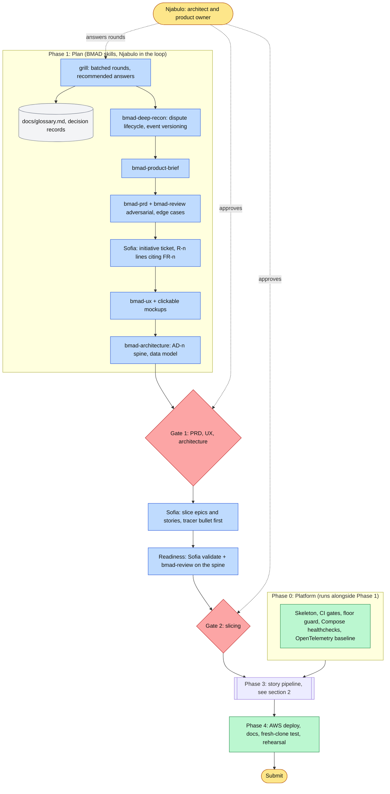
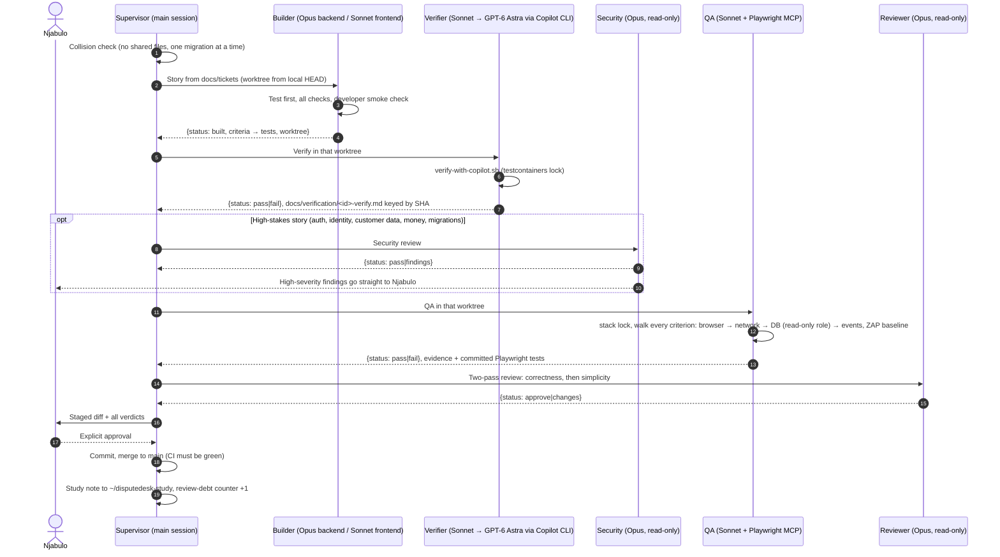
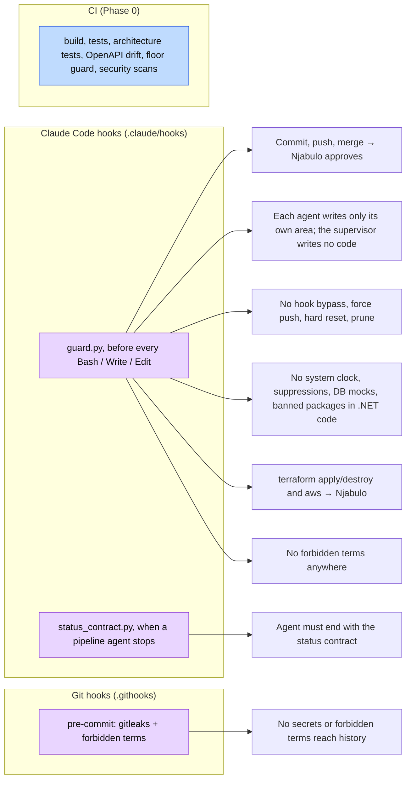

# Agent-assisted SDLC

How DisputeDesk is planned, built, verified and shipped with AI agents, and where the human stays in control. The multi-agent layer is optional: everything here can also be done by a person with any AI assistant, following [AGENTS.md](../../AGENTS.md).

## 1. The lifecycle

## 2. One story through the pipeline

The main Claude Code session is the supervisor: it dispatches, tracks and merges, and never writes code.

A failed stage sends the story back to its builder with the findings. After two failed attempts the builder returns `blocked` and the supervisor asks Njabulo.

## 3. What enforces the rules

Prose rules get violated, so the critical ones are tooling.

## Agents, skills and files

| Piece | Where |
|---|---|
| Rules for every assistant | `AGENTS.md` |
| Supervisor instructions | `CLAUDE.md` (plus the gitignored `CLAUDE.local.md`) |
| Agents | `.claude/agents/` — `backend-builder`, `frontend-builder`, `verifier`, `qa`, `reviewer`, `security` |
| Story procedures | `.claude/skills/` — `build-story`, `verify-story`, `qa-story`, `review-story`, `security-story`, `grill` |
| Planning skills | BMAD v7, pinned in `skills-lock.json`, restored by `scripts/bmad-install.sh` (not committed), configured in `_bmad/config.toml` and `_bmad/custom/` |
| Hooks and settings | `.claude/hooks/`, `.claude/settings.json` |
| MCP servers | `.mcp.json` — Microsoft Learn, Playwright |
| Shared-resource locks | `scripts/test-lock.sh` (`stack`, `testcontainers`) |
| Non-author verification | `scripts/verify-with-copilot.sh` |
| Machine setup | `scripts/bootstrap.sh` |
| Model choices | [ad-004](../decisions/ad-004-model-roles.md) |
| Where the workflow comes from | [workflow-sources.md](workflow-sources.md) |
