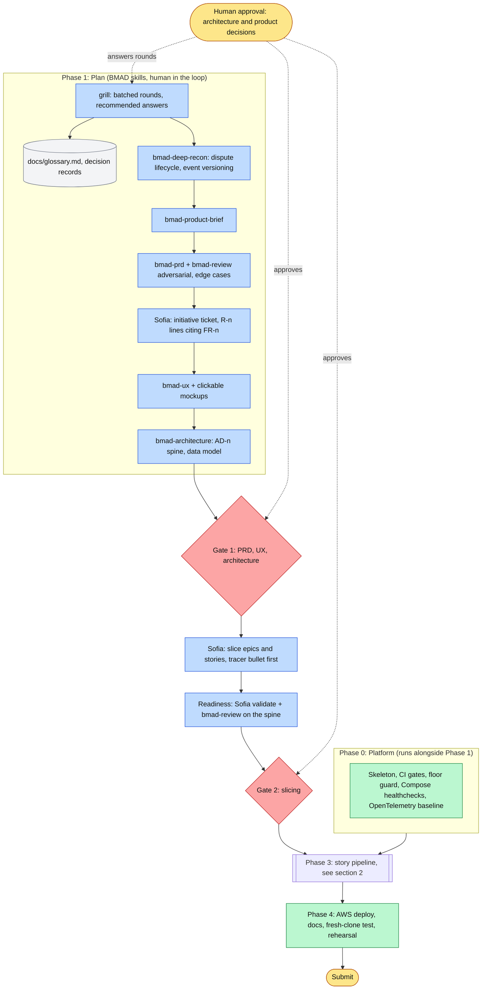
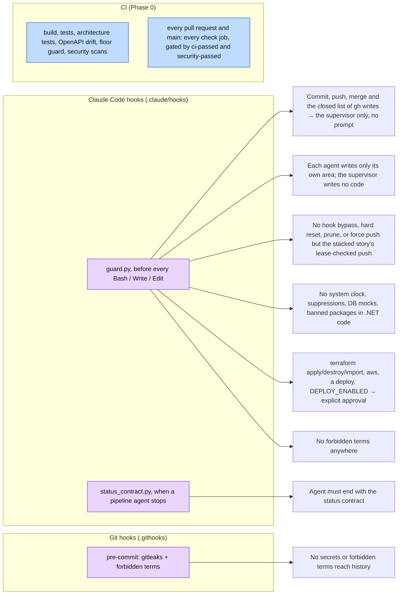

# Agent-assisted SDLC

How DisputeDesk is planned, built, verified and shipped with AI agents, and where the human stays in control. The multi-agent layer is optional: everything here can also be done by a person with any AI assistant, following [AGENTS.md](../../AGENTS.md).

## 1. The lifecycle



## 2. One story through the pipeline

The main Claude Code session is the supervisor: it dispatches, tracks and merges, and never writes code.

```mermaid
sequenceDiagram
    autonumber
    actor N as Human approver
    participant S as Supervisor (main session)
    participant B as Builder (Opus backend / Sonnet frontend)
    participant V as Verifier (Sonnet → GPT-6 Astra via Copilot CLI)
    participant SEC as Security (Opus, writes only its record)
    participant Q as QA (Sonnet + Playwright MCP)
    participant R as Reviewer (Opus, writes only its record)

    S->>S: check-ready, collision check (stacked on feature/<base> when it depends on an unmerged story)
    S->>B: Story from docs/tickets (worktree from main, or from feature/<base>)
    B->>B: Test first, all checks, one full run with a results file, breaks list, developer smoke check
    B-->>S: {status: built, criteria → tests, breaks, test_results}, <id>-build.json in the worktree
    par Post-build review, records in docs/verification/
        S->>R: Correctness, plus the security checklist below High-stakes
        R-->>S: <id>-review.md, findings high / medium / low
    and
        S->>V: Read the results file, run the breaks list
        V->>V: verify-with-copilot.sh, run-breaks in a throwaway copy (testcontainers lock, stack lock for DisputeDesk.PlatformTests names, a filter matching no test is an error)
        V-->>S: <id>-verify.md keyed by SHA and diff hash, findings
    and High-stakes story only (auth, identity, customer data, money, migrations)
        S->>SEC: Security review
        SEC-->>S: <id>-security.md, findings
        SEC-->>N: High-severity findings escalated for a decision
    end
    opt High or medium findings (at most two rounds, then the human)
        S->>B: <id>-fixes.md to a fresh builder; the stages re-run on the delta
    end
    opt Story changes a user journey, the HTTP surface, data or events
        S->>Q: QA in that worktree
        Q->>Q: stack lock for this run only, walk every criterion: browser → network → DB (read-only role) → events
        Q-->>S: {status: pass|fail}, <id>-qa.md + committed Playwright tests
    end
    S->>S: Commit on feature/<id>, push, open the pull request (base main, or feature/<base> when stacked)
    S->>S: Wait for its required checks, arm squash auto-merge on base main pinned to the checked head
    S->>S: Confirm the squash commit, wait for main's CI and Security runs on it (publish)
    S-->>N: Report after the merge; High-stakes diffs in the review blocks
```

Before dispatch the supervisor runs `scripts/check-ready.sh <story>`, which fails while a `[story]` point in the pre-build review has no Sofia disposition, a `[decision]` point exists but the story's front matter lacks `decisions: settled` (the supervisor sets it, citing the epic's `epic-<epic>-decisions.md`, once the human has answered), or a story in the `after` list is neither done nor pushed as a `feature/<id>` branch on origin.

Pre-build, one reviewer reads each Feature and High-stakes story with the review and security checklists; there is no per-story challenger. The challenger runs only in decision mode, on a new or changed architecture decision, PRD or brief.

Only high and medium findings send the story to a fix round. Lows go to `docs/verification/epic-<epic>-lows.md` and are fixed in one batch per epic. After two fix rounds a story that still has a high or medium finding goes to the human.

A fix round goes to one fresh builder, whose isolated worktree starts at the base commit, not at the story's uncommitted change. The supervisor runs `scripts/story-patch.sh <story-worktree> <base> <patch>`, which writes the change as one binary patch and fails unless the patch reproduces the worktree; the fix brief starts with `git apply --binary --exclude='docs/*' <patch>`, and the builder's worktree becomes the story worktree.

A fix item that moves a header, or the component that owns a behaviour, lists every response or path the criterion names, each with its expected value.

A lane on a worker machine runs through `scripts/lane.sh start|wait|collect <host> <story> ...`: it starts a headless builder in a tmux session, waits for its exit file, and brings back the report and a verified patch. Two machines (M1 and M2) run two lanes each; `lane.sh start` refuses a lane under 15 GB free, and the supervisor fills a lane the moment it frees.

The verifier does not re-run the suite. It checks that the builder's results files cover the current diff (the diff hash in `<story>-build.json`), judges each criterion against its test, and runs each `breaks` entry in a throwaway copy: apply the patch, run the named test, expect a failure. A break that still passes, or a results file for another diff, is a high finding.

Every change reaches main through its pull request (AGENTS.md, Commits): a story on `feature/<story>`, any other change on `feature/<slug>`, the records of a merged story on `feature/records-<story>`. Every `gh` write and read-back runs as the repository owner, `GH_TOKEN="$(gh auth token --user <owner>)" gh …`, written `gh` below; the token is never printed, logged or written to a file. Once every stage the change needs has passed, the supervisor:

1. pushes the branch, `git push origin feature/<id>`, and opens the pull request, `gh pr create --head feature/<id> --base <base> --title <title> --body <body>`, where `<base>` is `main`, or `feature/<base>` for a stacked story, and `<title>` is the commit-message subject (one line, at most 72 characters);
2. waits for the required checks, `gh pr checks <n> --watch --required`;
3. arms the merge only when `gh pr view <n> --json baseRefName` reads `main`: `gh pr merge <n> --squash --auto --match-head-commit <sha>`, where `<sha>` is the full 40-character SHA of the commit whose tree the stages checked, or the head `gh pr update-branch` made from it once its checks pass;
4. before any later push to an armed pull request, runs `gh pr merge <n> --disable-auto`, and re-arms with the new head once its checks pass;
5. if the pull request still reads `OPEN` once its checks pass, reads `gh pr view <n> --json mergeStateStatus`: `BEHIND` takes the update below, `BLOCKED` waits, `DIRTY` goes to a builder as a fix round;
6. confirms the merge and its squash SHA, `gh pr view <n> --json state,mergeCommit`, then finds main's runs on it, `gh run list --branch main --commit <squash sha> --workflow CI` (and `Security`), and waits for each, `gh run watch <id> --exit-status`.

A pull request that is only behind main gets `gh pr merge <n> --disable-auto`, then `gh pr update-branch <n>`, with no force push; the local branch then takes the remote head first (`git fetch` and a fast-forward), and the merge is re-armed with the new head once its checks pass, with no other stage re-run. A `DIRTY` pull request, or a drift check that fails after an update, goes to a builder as a fix round, since the supervisor writes no code.

A stacked story's pull request has the base `feature/<base>`. When the base's pull request squash-merges, GitHub deletes `feature/<base>` and retargets the stacked pull request to main ([Managing branches within your repository](https://docs.github.com/en/pull-requests/how-tos/commit-changes/managing-branches-within-your-repository), Deleting a branch); the supervisor confirms it with `gh pr view <n> --json baseRefName` (else `gh pr edit <n> --base main`). It takes the base's last head from `gh pr view <base-pr> --json headRefOid`, runs `git fetch origin` and `git rebase --onto origin/main <that sha> feature/<story>` (on a conflict, `git rebase --abort` and a fix round), and pushes with the one force push the guard lets through, `git [-C <path>] push --force-with-lease --force-if-includes origin feature/<story>`, as the whole command. The pull request's checks run again before any merge.

Pull-request checks test GitHub's merge of the up-to-date branch into main, and main's own run builds, scans and publishes the squash commit (ad-012). Main is never force-pushed, and its ruleset refuses it.

## 3. What enforces the rules

Prose rules get violated, so the critical ones are tooling.



Every check job runs on every pull request and on every push to main, a docs-only change included (ad-012, clause 1), and `ci-passed` and `security-passed` gate them. The ZAP baseline is one of them, so QA runs no ZAP scan of its own.

## Agents, skills and files

| Piece | Where |
|---|---|
| Rules for every assistant, delivery process included | `AGENTS.md` |
| Claude Code mechanics (guard hook, agents, skills, dispatch) | `CLAUDE.md` (plus the gitignored `CLAUDE.local.md`) |
| Agents | `.claude/agents/` — `backend-builder`, `frontend-builder`, `verifier`, `qa`, `reviewer`, `security` |
| Story procedures | `.claude/skills/` — `build-story`, `verify-story`, `qa-story`, `review-story`, `security-story`, `grill` |
| Planning skills | BMAD v7, pinned in `skills-lock.json`, restored by `scripts/bmad-install.sh` (not committed), configured in `_bmad/config.toml` and `_bmad/custom/` |
| Hooks and settings | `.claude/hooks/`, `.claude/settings.json` |
| MCP servers | `.mcp.json` — Microsoft Learn, Playwright |
| Shared-resource locks | `scripts/test-lock.sh` (`stack`, `testcontainers`) |
| Non-author verification | `scripts/verify-with-copilot.sh` |
| Machine setup | `scripts/bootstrap.sh` |
| Model choices | [ad-004](ad-004-model-roles.md) |
| Where the workflow comes from | [workflow-sources.md](workflow-sources.md) |
