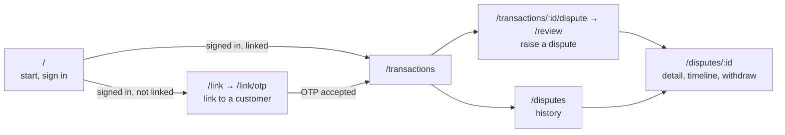
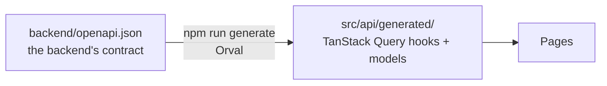

# frontend

The frontend team's folder: the DisputeDesk single-page app (React and TypeScript, shadcn/ui on Tailwind, TanStack
Query and Router), its tests, and the Dockerfile that builds it. Its rules are in [AGENTS.md](../AGENTS.md) and
[docs/conventions/frontend.md](../docs/conventions/frontend.md). Node is pinned in `../.nvmrc`.

## Pages



- Each page belongs to one sign-in state: anonymous, unlinked or linked. Opening another state's page redirects to the
  user's own home page.
- `/signed-out?reason=expired` explains an ended session. Any other path shows _not found_.

## Commands

```sh
npm ci                # install exactly what package-lock.json pins
npm run dev           # Vite dev server; /api and /otlp go to the local gateway (http://localhost:8080)
npm run build         # type-check, then build into dist/
npm run typecheck     # tsc --noEmit
npm run lint          # eslint
npm run format        # prettier --check (format:write rewrites)
npm test              # Vitest, with axe accessibility checks
npm run generate      # Orval: regenerate src/api/generated
```

CI's `frontend` job also runs `npm audit --omit=dev --audit-level=high`. It runs `npm run generate` too, and fails if
`src/api/generated/` changes.

## The API client



Nobody edits `src/api/generated/` by hand. Regenerate it after `openapi.json` changes.

## The built SPA

`Dockerfile` builds an image that holds only the built files, at `/dist/`, with no operating system. The gateway copies
them in. From the repository root:

```sh
docker build -t disputedesk-spa frontend
docker build --build-arg BROWSER_TELEMETRY=off -t disputedesk-spa frontend   # no browser tracing in the bundle
```

`BROWSER_TELEMETRY` defaults to `on`. Only the exact value `off` leaves browser tracing out.

## Files that identity provisioning reads

Zitadel provisioning mounts four files from `src/theme/` to brand the sign-in page:

- `tokens.css`
- `fonts/nunito-sans-latin-400-normal.woff2`
- `wordmark.png`
- `wordmark-dark.png`

Renaming or moving any of them is a cross-team change
([ad-011](../docs/decisions/ad-011-team-folders-in-one-repo.md)).
