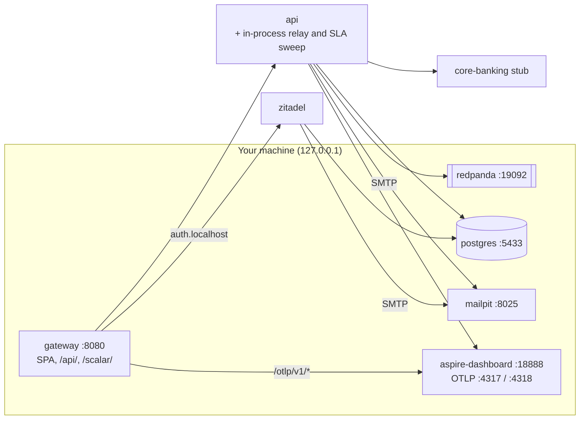
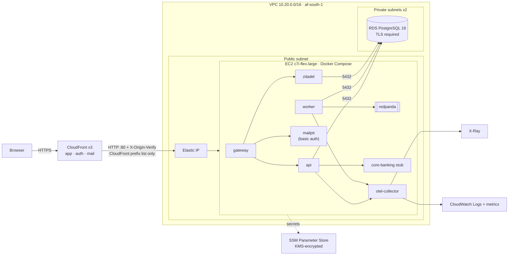
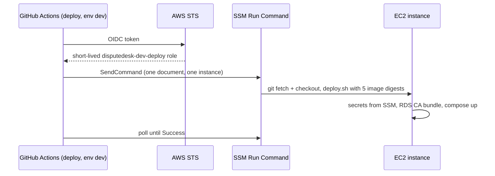

# infra

Everything the DevOps team owns:
- the local Compose platform (`docker-compose.yml` at the repo root);
- the AWS environment (Terraform);
- the deploy;
- the gateway, identity and collector images;
- the database init;
- the tests of all of it.

## Local stack



```sh
docker compose up --build --wait   # fully provisioned, no manual steps
docker compose down -v             # stop and delete all data
scripts/test-lock.sh run stack <owner> -- infra/tests/smoke.sh   # black-box check; starts and ends with down -v
```

- **Ports.** Every host port except the gateway's 8080 can be moved, for example
  `DISPUTEDESK_OTLP_HTTP_PORT=14318 docker compose up --wait`. The variables are listed in the header of
  `docker-compose.yml`.
- **Redpanda Console** (topics and messages in a browser) is optional:
  `docker compose --profile console up -d --wait redpanda-console`, then <http://localhost:8081>. The AWS deploy never
  enables it.
- **A second stack** beside this one needs its own `COMPOSE_PROJECT_NAME` and `DISPUTEDESK_SUBNET`. The default
  subnet is `10.201.89.0/24`, pinned because the api trusts forwarded headers only from it (AD-23). Only one stack can
  hold port 8080.

## Deployed on AWS

One EC2 instance runs the same Compose stack. It sits behind CloudFront, with PostgreSQL on RDS. The environment is
partly applied: the CloudFront distributions wait on AWS account verification, and the application has not been
deployed yet ([terraform/README.md](terraform/README.md)).



How a deploy reaches the instance. There is no SSH; the only way in is SSM:



- Deploys run from `main` only. A deploy on every merge stays switched off until the repository variable
  `DEPLOY_ENABLED` is `true`; a hand-dispatched deploy (`deploy.yml`) works either way.
- Images come from GHCR, pinned by digest.
- Only the api and the collector can reach instance metadata.

## Folders

| Folder | What |
|---|---|
| `images/gateway/` | nginx serving the SPA and routing by host. `templates/` holds the local config: app and identity hosts, security headers and CSP, a coarse rate limit, the `/otlp/` proxy. `templates-aws/` holds the AWS config: app, identity and Mailpit hosts, each requiring CloudFront's origin-verify header |
| `images/zitadel/` | Zitadel on pinned Alpine. `provision.sh` runs at start and creates the project, roles, web app, operations client, fixture logins and login branding. `verify.sh` checks the result |
| `images/postgres/` | Database init: the `disputedesk` app role, the `zitadel` role, and the read-only `qa_readonly` role |
| `images/otel-collector/` | The collector config for AWS: OTLP in; X-Ray, CloudWatch Logs and metrics out (AD-29) |
| `deploy/aws/` | `compose.yml`, the AWS override. `deploy.sh` runs on the instance: it writes `.env`, fetches the RDS CA bundle, writes the gateway's CloudFront real-IP config, runs the first database init, blocks metadata access, and starts Compose. `input-bounds.sh` holds the input bounds |
| `deploy/runbook.md` | Operator procedures for the local stack |
| `terraform/` | `bootstrap/`, the state bucket. `envs/dev/`, the environment and its mocked-provider tests. The modules: network, compute, database, edge, observability, deploy-role, budget. See [terraform/README.md](terraform/README.md) |
| `tests/` | `smoke.sh`, and `DisputeDesk.PlatformTests`, the xUnit tests of everything above |

`DisputeDesk.PlatformTests` covers:

| Test class | Checks |
|---|---|
| `GatewayTests` | Builds both gateway images and checks the responses on a throwaway network |
| `ComposeRenderTests` | Renders the local and AWS Compose models and the collector config |
| `DeployScriptTests` | Runs `deploy.sh` with its external commands stubbed, and every input bound |
| `DatabaseInitTests` | Runs the init against a throwaway PostgreSQL 18 over TLS |
| `IamNamesTests`, `IamNamesRulesTests`, `ServiceReferenceFetchTests` | Every IAM action in the policy templates exists in AWS's public service reference |
| `PlatformScriptTests`, `LabelPolicyTests` | The provisioning scripts, run against a stub |
| `ShellHarnessTests` | Shell test harnesses stay out of `infra/` |

## Tests

You need the .NET SDK from `tests/global.json`, Docker with Compose v5.6.1, `bash`, `curl`, `jq` and `openssl`.
`IamNamesTests` also needs the network.

The gateway and database-init tests start containers on the shared Docker daemon, so run them under the `stack`
lock:

```sh
scripts/test-lock.sh run stack <owner> -- bash -c 'cd infra/tests && dotnet test --project DisputeDesk.PlatformTests'
```

## Credentials (local, dev-only)

| What | Where |
|---|---|
| Customer logins | [backend/fixtures/local.json](../backend/fixtures/local.json), listed in the [root README](../README.md#try-it) |
| Zitadel console admin | `admin` / `Dev-Only-Admin-1` at <http://auth.localhost:8080/ui/console> |
| Database passwords, Zitadel master key | Inline defaults in `docker-compose.yml`, which an untracked `.env` can override |
| Generated client secrets | Written by the provisioner, read with `docker compose exec -T zitadel cat /provision/out/zitadel-clients.json` |
| A browserless sign-in | `scripts/dev-login.sh <login>` leaves a session in a cookie jar |

- **After changing what the provisioner creates**, run `docker compose down -v` once. It never edits an app that
  already exists.
- **If provisioning fails**, `docker compose up` fails too. Fix the cause, then run `docker compose restart zitadel`.

<details>
<summary><strong>Owner only: repository settings</strong> (applied once, by hand)</summary>

`main` is protected by a ruleset, and squash is the only merge method (ad-012, AD-32). The owner applies both, with
the owner's token; the token is never printed. Apply them only after a pull request has shown `ci-passed` and
`security-passed` from the GitHub Actions app.

1. Set the `FORBIDDEN_TERMS` secret, which CI's floor guard needs:

   ```sh
   GH_TOKEN="$(gh auth token --user njabulozmnisi)" gh secret set FORBIDDEN_TERMS --app actions -R njabulozmnisi/disputedesk < .claude/forbidden-terms.local
   ```

2. Apply the ruleset, [`.github/rulesets/main.json`](../.github/rulesets/main.json):

   | Rule | Effect |
   |---|---|
   | `bypass_actors: []` | No one bypasses it, the owner included |
   | `deletion`, `non_fast_forward` | `main` cannot be deleted or force-pushed |
   | `pull_request` | Every change arrives by pull request |
   | `required_status_checks` | `ci-passed` and `security-passed`, from the GitHub Actions app only, on a branch up to date with `main` |
   | `code_scanning` | CodeQL results are required; a high or error alert blocks the merge |

   ```sh
   # First time: create it and print its id.
   GH_TOKEN="$(gh auth token --user njabulozmnisi)" gh api --method POST repos/njabulozmnisi/disputedesk/rulesets --input .github/rulesets/main.json --jq .id
   # Find the id again if lost:
   GH_TOKEN="$(gh auth token --user njabulozmnisi)" gh api repos/njabulozmnisi/disputedesk/rulesets --jq '.[] | {id,name}'
   # Later: replace it in place.
   GH_TOKEN="$(gh auth token --user njabulozmnisi)" gh api --method PUT repos/njabulozmnisi/disputedesk/rulesets/<id> --input .github/rulesets/main.json
   # Read it back. No output means it matches; a difference may be a parameter GitHub adds
   # (for example allowed_merge_methods), which is recorded with the read-back.
   diff <(jq -S . .github/rulesets/main.json) \
     <(GH_TOKEN="$(gh auth token --user njabulozmnisi)" gh api repos/njabulozmnisi/disputedesk/rulesets/<id> \
       --jq '{name,target,enforcement,bypass_actors,conditions,rules}' | jq -S .)
   ```

3. Make squash the only merge method, with auto-merge on and head branches deleted:

   ```sh
   GH_TOKEN="$(gh auth token --user njabulozmnisi)" gh api --method PATCH repos/njabulozmnisi/disputedesk \
     -F allow_squash_merge=true -F allow_merge_commit=false -F allow_rebase_merge=false \
     -F allow_auto_merge=true -F delete_branch_on_merge=true \
     -f squash_merge_commit_title=PR_TITLE -f squash_merge_commit_message=PR_BODY
   ```

   Read it back:

   ```sh
   GH_TOKEN="$(gh auth token --user njabulozmnisi)" gh api repos/njabulozmnisi/disputedesk \
     --jq '{allow_squash_merge,allow_merge_commit,allow_rebase_merge,allow_auto_merge,delete_branch_on_merge,squash_merge_commit_title,squash_merge_commit_message}'
   ```

There is no linear-history rule and no merge queue. Squash is enforced by these settings. GitHub offers merge queues
only to organisation-owned repositories, and the up-to-date requirement gives the same guarantee.

</details>
