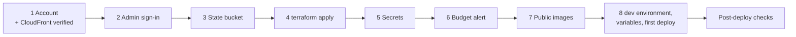

# The AWS dev environment

**Status:** steps 1–8 are done. The first deploy ran on 2026-11-07, and the post-deploy checks pass, except check 7's
reboot step, which has not run yet.
Every deploy is dispatched by hand and approved. A merge to `main` publishes images but never deploys them.

There is one environment (AD-28):
- one EC2 instance runs the same Compose stack as local, plus `infra/deploy/aws/compose.yml`;
- RDS PostgreSQL holds both databases;
- three CloudFront distributions (app, auth, mail) are the only public entry;
- GitHub Actions deploys through SSM Run Command, with an OIDC role and no stored key.

[infra/README.md](../README.md#deployed-on-aws) has the architecture diagram.



| Folder | What |
|---|---|
| `bootstrap/` | The S3 state bucket for `envs/dev`. It has local state and is applied once |
| `envs/dev/` | The one root: the KMS key, the SSM values the deploy reads, and the modules |
| `modules/network` | A VPC with one public subnet (internet gateway, no NAT) and two private subnets for RDS |
| `modules/compute` | The c7i-flex.large instance (AL2023, IMDSv2, no SSH), its Elastic IP, security group, role and user data |
| `modules/database` | RDS PostgreSQL 18 on db.t4g.micro, private, TLS required, with the master password in write-only arguments |
| `modules/edge` | The three CloudFront distributions and the origin-verify value |
| `modules/deploy-role` | GitHub's OIDC provider, the deploy role (trusted only for the `dev` environment, which only `main` may use), and its Run Command document |
| `modules/observability` | The collector's log group, and X-Ray Transaction Search |
| `modules/budget` | The monthly cost budget and its four email alerts |

- Every IAM policy is a `<name>.json.tftpl` file beside its `main.tf`.
- `IamNamesTests` in `infra/tests` checks every action in those files against AWS's public service reference.

## Know before you apply

| Risk | Accepted because | Production path |
|---|---|---|
| The fixture logins and their published passwords work on AWS | Only synthetic data is held | [P50](../../docs/production-path.md#p50-demo-logins-in-aws) |
| CloudFront reaches the origin over plain HTTP. The default certificate allows TLS 1.0, and there is no WAF | No real data | [P52](../../docs/production-path.md#p52-edge-transport) |
| The instance's managed SSM and CloudWatch policies are broader than least privilege | The account is dedicated | [P56](../../docs/production-path.md#p56-instance-role) |
| The api and the collector reach instance metadata, so a compromise of either exposes every deploy secret | No real data | [P61](../../docs/production-path.md#p61-deploy-secrets-apart-from-the-containers-credentials) |
| The gateway's CloudFront IP list is refreshed only at each deploy | The security group's prefix list follows AWS at once | |

- **Terraform state holds three secrets:** the origin-verify value (twice: the generated value and its SSM copy) and
  the budget email address.
- The RDS master password never enters state, because it is passed in write-only arguments.
- The state bucket is private, versioned, encrypted and HTTPS-only.
- **The repository must be public.** The instance clones it and fetches from it anonymously.
- **A fork or rename** must also change the `ghcr.io/njabulozmnisi/` image owner in `.github/workflows/deploy.yml` and
  `ci.yml`.
- The Zitadel console is not exposed: the gateway answers 404 on `/ui/console`.

**Known issue.** `rds.force_ssl` has no `apply_method`, so every plan shows a one-line diff on the parameter group. It is
harmless, because PostgreSQL 15 and later default to 1 on RDS.

## Tools

- Terraform 1.17.1 (CI's version; any 1.11 or later works).
- AWS CLI 2.32.0 or later, for `aws login`.
- `gh`, signed in to the repository.

Run every command from the repository root unless it says otherwise. The region is one of `af-south-1`, `us-east-1`,
`us-west-2`, `eu-west-1` or `eu-central-1`:

```sh
export REGION=af-south-1
```

## 1. The account

1. Create a new AWS account on the free plan.
2. Turn on MFA for the root user. Never create access keys for it.
3. Enable the opt-in region if you chose `af-south-1`: Account, AWS Regions.
4. Get the account verified for CloudFront. A new account cannot create distributions until it is: open a support
   case under Account and billing.

## 2. The administrator's sign-in (temporary credentials only)

Sign in as an IAM user with a console password and MFA. `aws login` turns that console sign-in into temporary CLI
credentials. IAM Identity Center is not used, because its organisation instance ends the free plan's credits.

1. As root, create the IAM user `admin` with console access. Attach `AdministratorAccess` and
   `SignInLocalDevelopmentAccess`, and give it **no access keys**.
2. Sign in as `admin`, assign it an MFA device, and sign out of root.
3. On your machine:

   ```sh
   aws login --profile disputedesk --region "$REGION"
   export AWS_PROFILE=disputedesk
   aws sts get-caller-identity          # shows the admin user's ARN
   ```

   Terraform's AWS provider may not yet read the `aws login` session: step 4's plan then stops with "No valid credential
   sources found". If so, expose the same credentials through a process profile:

   ```sh
   cat >> ~/.aws/config <<EOF

   [profile disputedesk-process]
   credential_process = aws configure export-credentials --profile disputedesk --format process
   region = $REGION
   EOF
   export AWS_PROFILE=disputedesk-process
   ```

Never run `aws iam create-access-key`, and never put static keys into `aws configure`.

## 3. The state bucket (once)

```sh
cd infra/terraform/bootstrap
terraform init
terraform apply -var "aws_region=$REGION" -var "state_bucket_name=disputedesk-tfstate-<something unique>"
cd -
```

Keep `bootstrap/terraform.tfstate`, which is local and gitignored. It is needed to destroy the bucket at the end.

## 4. The environment

Check that the region offers both classes. Each command prints a value:

```sh
aws ec2 describe-instance-type-offerings --region "$REGION" --filters Name=instance-type,Values=c7i-flex.large \
  --query 'InstanceTypeOfferings[0].InstanceType' --output text
aws rds describe-orderable-db-instance-options --region "$REGION" --engine postgres --db-instance-class db.t4g.micro \
  --query "OrderableDBInstanceOptions[?starts_with(EngineVersion, '18.')].EngineVersion | [0]" --output text
```

- The budget address is personal data: pass it in the environment, never in a file.
- The repository's name, in GitHub's exact case, and its two numeric IDs build the deploy role's subject.

```sh
cd infra/terraform/envs/dev
terraform init -backend-config="bucket=disputedesk-tfstate-<something unique>" -backend-config="region=$REGION"
export TF_VAR_aws_region=$REGION
export TF_VAR_github_repository=$(gh api repos/<owner>/<name> --jq .full_name)
export TF_VAR_github_repository_owner_id=$(gh api repos/<owner>/<name> --jq .owner.id)
export TF_VAR_github_repository_id=$(gh api repos/<owner>/<name> --jq .id)
export TF_VAR_budget_limit_usd=10
export TF_VAR_budget_alert_email=<an address you read>
plan_file=$(mktemp -d)/dev.tfplan
terraform plan -out="$plan_file"
terraform apply "$plan_file"
rm -rf "$(dirname "$plan_file")"
cd -
```

The saved plan holds the origin-verify value and the budget address in clear text. That is why it goes to a temporary
directory and is deleted after the apply. Plans and applies run only from this machine, never from CI (AD-28).

## 5. The secrets a person creates

Each is a generated SecureString under `/disputedesk/dev`, encrypted with the environment's KMS key. Values pass through
a 0600 file, never the command line. Their bounds are checked by `infra/deploy/aws/input-bounds.sh` and `deploy.sh`.

```sh
SSM_PATH=/disputedesk/dev
KEY_ARN=$(aws ssm get-parameter --name "$SSM_PATH/DATAPROTECTION_KMS_KEY_ID" --query Parameter.Value --output text)
letters_and_digits(){ LC_ALL=C tr -dc 'A-Za-z0-9' < /dev/urandom | head -c "$1"; }
put_secret(){ # NAME: the value on standard input
  local file
  file=$(mktemp)          # mode 0600
  cat > "$file"
  aws ssm put-parameter --name "$SSM_PATH/$1" --type SecureString --key-id "$KEY_ARN" --value "file://$file" \
    --overwrite > /dev/null
  rm -f "$file"
}

letters_and_digits 64 | put_secret APP_DB_PASSWORD                  # [A-Za-z0-9]{32,128}
letters_and_digits 64 | put_secret ZITADEL_DB_PASSWORD              # [A-Za-z0-9]{32,128}
letters_and_digits 64 | put_secret QA_DB_PASSWORD                   # [A-Za-z0-9]{32,128}
letters_and_digits 32 | put_secret ZITADEL_MASTERKEY                # exactly 32 of [A-Za-z0-9]
{ letters_and_digits 60; printf 'Aa1-'; } | put_secret ZITADEL_ADMIN_PASSWORD   # [A-Za-z0-9-]{32,128}, each class
openssl rand -base64 32 | tr -d '\n' | put_secret LINKING_OTP_HMAC_KEY        # base64 of 32 bytes
{ printf 'mailpit:'; letters_and_digits 64; } | put_secret MAILPIT_UI_AUTH     # user:password, [A-Za-z0-9]
```

Terraform already wrote the other nine values the deploy reads, the RDS master password among them. The Api keeps its
Data Protection keys under `/disputedesk-dataprotection/dev`, which the deploy never reads.

## 6. The budget alert

AWS Budgets emails the step 4 address at 25 %, 50 % and 80 % of the actual monthly cost and at 100 % of the forecast,
credits excluded. It sends nothing until a threshold is crossed, so expect no email at setup. Check the budget instead:

```sh
aws budgets describe-budgets --account-id "$(aws sts get-caller-identity --query Account --output text)" \
  --query 'Budgets[].[BudgetName,BudgetLimit.Amount,CostTypes.IncludeCredit]'
```

A budget alerts; it does not stop spending.

## 7. The images

CI's `publish` job pushes five packages to GHCR from `main`:
- `disputedesk-api`
- `disputedesk-worker`
- `disputedesk-gateway`
- `disputedesk-core-banking`
- `disputedesk-zitadel`

GHCR creates them private. After the first publish, make each one public: open the package, then **Package settings** →
**Change visibility** → **Public**.

A private image fails a deploy in one of two places:
- a hand-dispatched deploy fails at its digest lookup, before it reaches AWS;
- a CI deploy fails at `docker pull` on the instance.

## 8. The environment, the repository variables and the first deploy

Create the GitHub environment `dev` before any workflow names it, allowing only `main`, with the owner as its required
reviewer, so every deploy waits for approval. A run that names a missing environment would create it with no
protection. `<owner-id>` is the owner's numeric ID, which the subject check below also prints.

```sh
gh api --method PUT repos/<owner>/<name>/environments/dev \
  -F 'deployment_branch_policy[protected_branches]=false' -F 'deployment_branch_policy[custom_branch_policies]=true' \
  -F 'reviewers[][type]=User' -F 'reviewers[][id]=<owner-id>'
gh api --method POST repos/<owner>/<name>/environments/dev/deployment-branch-policies -f name=main -f type=branch
```

Check the OIDC subject the deploy role trusts:

```sh
gh api repos/<owner>/<name>/actions/oidc/customization/sub
gh api repos/<owner>/<name> --jq '.owner.login, .owner.id, .name, .id'
```

- `use_default` and `use_immutable_subject` must both be `true`.
- `sub_claim_prefix` must match the subject pinned in `envs/dev/tests/deploy_role.tftest.hcl`:
  `repo:<owner>@<owner-id>/<name>@<repo-id>:environment:dev`.
- On a mismatch, stop and correct `modules/deploy-role` first.
- Repeat the check after a rename, a transfer, or a change to the OIDC settings.
- The first deploy's role assumption is the end-to-end proof.

Set the four repository variables and deploy by hand:

```sh
cd infra/terraform/envs/dev
gh variable set AWS_DEPLOY_ROLE_ARN  --body "$(terraform output -raw deploy_role_arn)"
gh variable set AWS_REGION           --body "$(terraform output -raw aws_region)"
gh variable set DEPLOY_INSTANCE_ID   --body "$(terraform output -raw deploy_instance_id)"
gh variable set DEPLOY_DOCUMENT_NAME --body "$(terraform output -raw deploy_document_name)"
cd -
gh workflow run deploy.yml --ref main -f sha="$(git rev-parse origin/main)"
gh run watch "$(gh run list --workflow deploy.yml --limit 1 --json databaseId --jq '.[0].databaseId')"
```

- The commit must be on `main`, and its five images must be published.
- The job waits until the `dev` environment's required reviewer approves it.
- The job fails, printing the deploy script's standard error, unless the command ends `Success`.

Every later deploy is the same dispatch, with the SHA to deploy.

Every deploy recreates every container (`docker compose up --force-recreate`), so a changed mounted file, such as the
collector's `config.yaml`, takes effect. The stack is briefly unavailable while the containers restart, and Mailpit's
inbox empties.

## A half-done database init

The first deploy creates the roles `disputedesk`, `zitadel` and `qa_readonly`, and the databases `disputedesk` and
`zitadel`. If it stopped part-way, every later deploy stops with "RDS holds only some of the roles and databases". No
data exists yet, so drop what was created and deploy again. Open a shell on the instance:

```sh
aws ssm start-session --target "$(terraform -chdir=infra/terraform/envs/dev output -raw deploy_instance_id)"
```

On the instance:

```sh
sudo -i
cd /opt/disputedesk
export PGPASSWORD=$(aws ssm get-parameter --name /disputedesk/dev/RDS_MASTER_PASSWORD --with-decryption \
  --query Parameter.Value --output text)
export PGHOST=$(grep '^DB_HOST=' .env | cut -d= -f2)
docker run --rm -i -e PGPASSWORD -e PGHOST -e PGSSLMODE=verify-full -e PGSSLROOTCERT=/run/rds/ca-bundle.pem \
  -e PGUSER=dbmaster -e PGDATABASE=postgres -v "$PWD/rds-ca-bundle.pem:/run/rds/ca-bundle.pem:ro" \
  "$(grep '^POSTGRES_IMAGE=' infra/deploy/aws/deploy.sh | cut -d= -f2)" psql -v ON_ERROR_STOP=1 <<'SQL'
DROP DATABASE IF EXISTS disputedesk;
DROP DATABASE IF EXISTS zitadel;
DROP ROLE IF EXISTS qa_readonly;
DROP ROLE IF EXISTS zitadel;
DROP ROLE IF EXISTS disputedesk;
SQL
unset PGPASSWORD
exit
```

Then run `deploy.yml` again with the same SHA.

## Post-deploy checks

Run them after the first deploy, and after any change to the Terraform or the AWS override.

1. Sign in at `https://<APP_HOST>` as a fixture customer and raise a dispute.
2. Within an hour, the dispute shows up in X-Ray, CloudWatch metrics (namespace `DisputeDesk`) and the
   `/disputedesk-dev/otel` logs. X-Ray's trace list indexes only a sample of spans, about 1 % by default, so look in
   `aws/spans` (CloudWatch, Transaction Search), which holds every span. Each command prints at least one line; the
   metrics are only the app's own `disputedesk.*` instruments (`disputedesk.disputes.raised` after a raise), because
   the collector drops every other metric:

   ```sh
   since=$(( ($(date +%s) - 3600) * 1000 ))
   aws logs filter-log-events --log-group-name aws/spans --start-time "$since" --filter-pattern '"disputes"' \
     --max-items 5 --query 'events[].message' --output text
   aws cloudwatch list-metrics --namespace DisputeDesk --query 'Metrics[].MetricName' --output text
   aws logs filter-log-events --log-group-name /disputedesk-dev/otel --log-stream-names otlp --start-time "$since" \
     --max-items 5 --query 'events[].message' --output text
   ```

3. Mailpit answers 401 without credentials at `https://<MAILPIT_HOST>/`. The app answers 404 on `/mailpit/`.
4. A direct request to the Elastic IP times out: `curl -m 10 http://<elastic IP>/`.
5. RDS is unreachable from outside: `nc -z -w 5 <DB_HOST> 5432` fails.
6. Both databases exist with the right owners. On the instance, set up as in *A half-done database init*, this prints
   `disputedesk|disputedesk` and `zitadel|zitadel`:

   ```sh
   docker run --rm -e PGPASSWORD -e PGHOST -e PGSSLMODE=verify-full -e PGSSLROOTCERT=/run/rds/ca-bundle.pem \
     -e PGUSER=dbmaster -e PGDATABASE=postgres -v "$PWD/rds-ca-bundle.pem:/run/rds/ca-bundle.pem:ro" \
     "$(grep '^POSTGRES_IMAGE=' infra/deploy/aws/deploy.sh | cut -d= -f2)" psql -tA -c \
     "SELECT datname, pg_get_userbyid(datdba) FROM pg_database WHERE datname IN ('disputedesk', 'zitadel') ORDER BY 1"
   unset PGPASSWORD
   ```

7. Mailpit cannot reach instance metadata, but the Api can, and both still hold after `sudo reboot`. On the instance,
   from `/opt/disputedesk`, this must time out:

   ```sh
   docker compose -f docker-compose.yml -f infra/deploy/aws/compose.yml exec mailpit \
     wget -T 5 -O - http://169.254.169.254/latest/meta-data/
   ```

   A 401 would mean the container reached the metadata service. The Api has credentials when, from your machine,
   `aws ssm get-parameters-by-path --path /disputedesk-dataprotection/dev --query 'length(Parameters)'` is at least 1.
8. `docker stats --no-stream` shows Redpanda under its 768 MiB limit.
9. CloudFront's prefix list fits the security group's rule quota. The first number must be below the second:

   ```sh
   aws ec2 describe-managed-prefix-lists --region "$REGION" \
     --filters Name=prefix-list-name,Values=com.amazonaws.global.cloudfront.origin-facing \
     --query 'PrefixLists[0].MaxEntries' --output text
   aws service-quotas get-service-quota --region "$REGION" --service-code vpc --quota-code L-0EA8095F \
     --query Quota.Value --output text
   ```

10. The budget email arrives once the actual cost crosses 25 %, 50 % or 80 % of the budget, or the forecast crosses
    100 %. Until then, check the recipient as in step 6.
11. Plain HTTP is refused on the APIs and the identity host, and redirected for the app's pages. The first three print
    `403` with no `Location`, and the last two print `301` to `https://`:

    ```sh
    for url in "http://<APP_HOST>/api/health/live" "http://<MAILPIT_HOST>/api/v1/messages" \
               "http://<AUTH_HOST>/oauth/v2/token" "http://<APP_HOST>/" "http://<APP_HOST>/api"; do
      curl -sS -m 10 -o /dev/null -w "%{http_code} Location: %header{location} $url\n" "$url"
    done
    ```

## Rollback

Dispatch an earlier `main` SHA whose images are still in GHCR:

```sh
gh workflow run deploy.yml --ref main -f sha=<the earlier SHA>
```

A revert on `main` also works: once its images are published, dispatch the revert's SHA. Migrations are not rolled
back, so a rollback past one relies on it staying compatible with the earlier code.

## Destroy

First delete what Terraform did not create: the person-made secrets and the Api's key ring.

```sh
for name in APP_DB_PASSWORD ZITADEL_DB_PASSWORD QA_DB_PASSWORD ZITADEL_MASTERKEY \
  ZITADEL_ADMIN_PASSWORD LINKING_OTP_HMAC_KEY MAILPIT_UI_AUTH; do
  aws ssm delete-parameter --name "/disputedesk/dev/$name"
done
aws ssm get-parameters-by-path --path /disputedesk-dataprotection/dev --recursive --query 'Parameters[].Name' \
  --output text | tr '\t' '\n' | xargs -r -n 10 aws ssm delete-parameters --names

cd infra/terraform/envs/dev
# The same variables as step 4, or destroy prompts for each.
export TF_VAR_aws_region=$REGION
export TF_VAR_github_repository=$(gh api repos/<owner>/<name> --jq .full_name)
export TF_VAR_github_repository_owner_id=$(gh api repos/<owner>/<name> --jq .owner.id)
export TF_VAR_github_repository_id=$(gh api repos/<owner>/<name> --jq .id)
export TF_VAR_budget_limit_usd=10
export TF_VAR_budget_alert_email=<the same address>
terraform destroy
cd -
```

Three things remain afterwards:
- The state bucket. Empty every object version, then run `terraform destroy` in `bootstrap/`.
- The KMS key, deleted at the end of its 7-day window.
- The `aws/spans` log group, created by X-Ray. Delete it with `aws logs delete-log-group --log-group-name aws/spans`.
